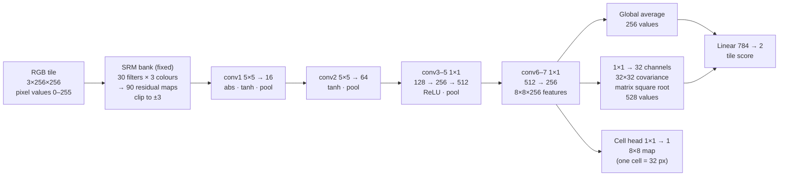
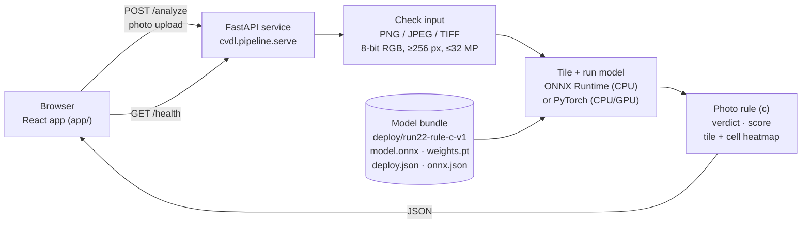
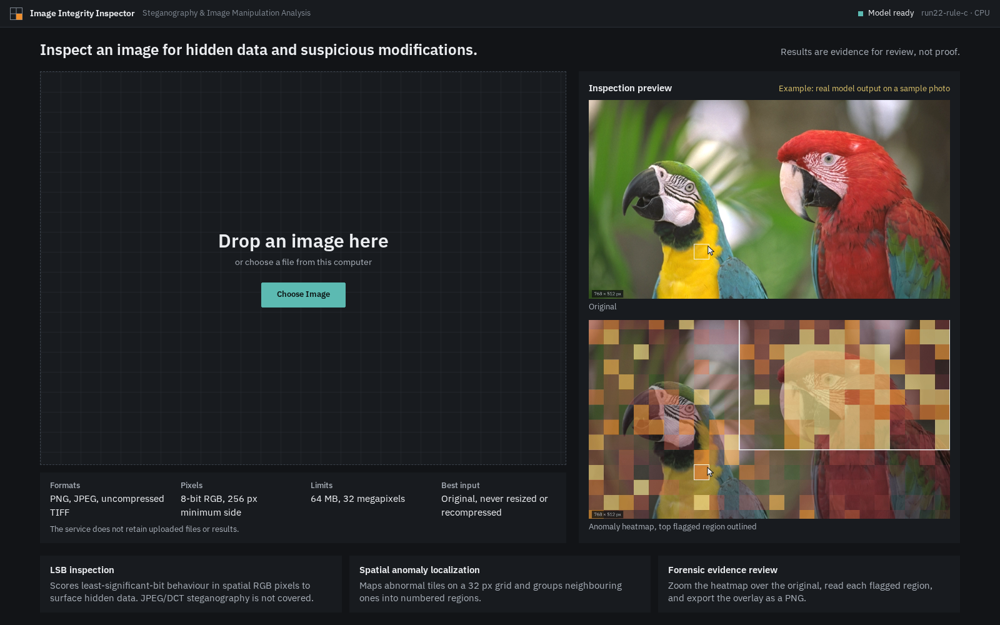

# Finding Hidden Messages in Photographs: a CNN for Colour LSB Steganalysis with a Localisation Heatmap

AAI3001 Computer Vision and Deep Learning

| Item | Where |
| --- | --- |
| Live demo | <https://gcp-aai3001.taild62d21.ts.net> |
| Run it locally | [Appendix A](#appendix-a-run-and-reproduce) |
| Shipped model | [`deploy/run22-rule-c-v1/`](deploy/run22-rule-c-v1/) (run 22, ONNX and PyTorch) |

---

## Abstract

*Steganography* hides a message inside an ordinary file. The simplest and most common tool for photos changes the **least significant bits (LSB)** of the pixel values. Each changed pixel moves by about ±1 out of 255, which no person can see. We built a detector that receives an RGB photo and answers two questions: *does this photo carry a hidden message?* and *where?*

We made our own labelled dataset. A deterministic generator embeds messages into 31,100 real photos from four public collections (RAISE, DIV2K, ALASKA2, LSDIR). It records, for each image, the settings used and a mask of every pixel that carries the message. The model is a 0.64 M-parameter convolutional neural network (CNN). It has a fixed bank of 30 high-pass filters (SRM), a widened XuNet body, a covariance-pooling head, and a second output head that we trained on the pixel masks to make a 32 px heatmap. Training data is generated on the fly, so every epoch has new messages; a parallel, deterministic data pipeline keeps the GPU supplied. Every model was scored on the same frozen test sets, with photo-level bootstrap intervals.

On 10,944 test pairs from photos that were never seen in training, the shipped model (run 22) has an error rate P_E of **2.54%** (AUC .997). The course-style baseline had 4.05%. On the hardest case, a 1-bit message at low payload, AUC rises from .627 to **.798**. For whole photos, a small logistic rule flags **5.6%** of clean test photos and misses 10.2% of photos with a message. We export the model to ONNX Runtime with no change in any of the 21,888 test decisions. This makes the service image 3.5× smaller and 1.7–2.3× faster than PyTorch on CPU. The public cloud demo runs on an NVIDIA L4 GPU, 6–8× faster than the cloud VM's CPU, with no change in any of 50 test verdicts. A React web app shows the verdict and the heatmap.

---

## 1. Introduction

LSB steganography writes message bits into the lowest bits of pixel values. The image looks the same, and file size and metadata do not change. A detector must therefore find small statistical changes in the image noise, and the natural noise of the photo masks those changes. The masking is strongest in noisy photos from small-sensor phone cameras.

Steganalysis of this kind is used in image forensics and content screening, where an analyst must decide which images to examine further. A single score gives the analyst no evidence to check. This work therefore produces a score, a photo-level verdict and a map of the regions that most likely carry the message.

The contributions of this work are:

| # | Contribution | Section |
| --- | --- | --- |
| C1 | A deterministic, labelled LSB dataset generator. It has 8 kinds of embedding setting. Each image comes with a pixel mask, and the generator can re-create any image exactly to verify it | [3.2](#32-the-generator-and-its-labels) |
| C2 | Frozen benchmarks, split by photo: a standard test, three domain-shift panels (seen cameras, unseen cameras, another collection), a 32-cell hard test, a cell-map test and a whole-photo test | [3.4](#34-frozen-test-sets) |
| C3 | A detector that combines an SRM front end, a widened XuNet, covariance pooling and a trained cell head, with paired clean/stego training on a deterministic, on-the-fly data pipeline | [4](#4-method) |
| C4 | A model history: 10 models scored on the same tests, so the effect of each design step is measured, not guessed | [6.3](#63-what-made-the-difference-model-history) |
| C5 | A deployed system: a checked model bundle, a CPU-optimised ONNX engine, an HTTP API, a container image and a web app | [7](#7-system-and-deployment) |

---

## 2. Background and related work

**LSB embedding.** Each 8-bit pixel channel stores a value from 0 to 255. *LSB replacement* overwrites the lowest bit with a message bit. *LSB matching* (±1 embedding) adds or subtracts 1 when the bit does not already match. Tools can also use the lowest *k* bits, or one higher bit plane. The amount of hidden data is measured in **bits per pixel (bpp)**: message bits divided by the number of pixels.

**Statistical detectors.** The chi-square attack [1] detects the pairs of values that LSB replacement makes equal in frequency. RS analysis [2] and weighted-stego (WS) analysis [3, 4] estimate the length of the message. These detectors are precise for full-image LSB replacement with random message bits. They are weaker for LSB matching, small payloads and local embedding.

**Rich models.** The Spatial Rich Model (SRM) [5] computes many *noise residuals* (the image minus a prediction from its neighbours) with fixed high-pass filters. It then trains a classifier on the statistics of those residuals. The residual removes most of the image content and leaves the noise, where the message is.

**CNN steganalysis.** Qian et al. [6] started a CNN with one fixed high-pass filter, the "KV" kernel. XuNet [7] added an absolute-value layer, tanh activations and 1×1 convolutions, and it is small and stable. Ye-Net [8] started from the 30 SRM filters and cut their outputs at a fixed value (truncation). SRNet [9], Yedroudj-Net [10] and GBRAS-Net [11] are deeper designs, built mostly for *adaptive* embedding on greyscale 256×256 BOSSbase images. Deng et al. [12] showed that global **covariance pooling** helps steganalysis. Covariance pooling summarises how feature channels vary together, not only their averages. It uses iterative matrix square-root normalisation (iSQRT-COV [13]).

**Localisation.** Class activation mapping (CAM) [14] reads a coarse "where" map from a network trained only on image labels.

Our setting differs from most of this work in four ways:

1. Colour RGB photos, not greyscale.
2. A *mixture* of LSB settings, not one algorithm at one payload.
3. Messages that often fill only part of the image.
4. A *photo-level* decision plus a heatmap, not a tile-level label only.

We therefore kept the small XuNet family, which trains quickly and was the course baseline. We added the parts that our measurements supported (SRM, covariance pooling, a trained cell head) and we measured each one.

---

## 3. Dataset


*Figure 1. Top: one test photo from each source, with the 256 px tile grid. Middle: a clean tile, the same tile with a message (they look the same), and the change masks for contiguous, random and strided placement. Bottom: in a noisy ALASKA tile the noise covers the changes.*

### 3.1 Source photos

All splits are **by photo**: no tile of a test photo is used in training or validation. Each split is frozen in a CSV file in [`data/`](data/), identified by a SHA-256 hash.

| Source | Photos | Train / Val / Test | What it adds | Licence |
| --- | ---: | --- | --- | --- |
| RAISE [15] | 1,000 Nikon RAW (NEF), 6–16 MP | 701 / 150 / 149 | Large, clean, camera-native photos | Non-commercial research and education |
| DIV2K [16] | 900 PNG, 1–4 MP | 680 / 120 / 100 | **Never used in training**: a source the model has not seen | Academic research only |
| ALASKA2 [17] | 18,200 TIFF, ≤1 MP, 38 camera models | 13,500 / 1,000 / 1,700 seen-camera + **2,000 unseen-camera** | Many phones and cameras, very noisy photos. 8 camera models are held out completely | Source site terms |
| LSDIR [18] | 11,000 PNG, 0.3–11 MP | 7,000 / 1,500 / 2,500 | Varied web-scale scenes | Source site terms |

- RAISE NEF files are decoded with one fixed set of settings: rawpy/LibRaw, AHD demosaicing, camera white balance, no auto-brightness, 8-bit output ([`lsb_raw.py`](LSB-Dataset-Generator/lsb_raw.py)). A different decoder produces different noise, so a fixed decoder keeps the clean class consistent.
- [`data/<source>/photo_manifest.csv`](data/raise/) lists every photo's path, camera, size, tile grid and split. [`Datasets/README.md`](Datasets/README.md) gives the download links and checksums. Images are not stored in git.

### 3.2 The generator and its labels

[`LSB-Dataset-Generator/`](LSB-Dataset-Generator/README.md) is our own tool. It turns a clean image into a clean/stego pair and writes the labels. Every random choice comes from a seeded generator. `generate.py --verify` replays a dataset and checks that every byte is the same.

| Setting | Values used in training (each drawn uniformly) | Meaning |
| --- | --- | --- |
| `bit_mode` | `lowest`, `plane` | Use the lowest *k* bits, or only bit plane *k* |
| `k` | 1, 2, 3, 4 | Bit depth (the generator supports 1–8; 5–8 is an optional test) |
| `method` | `replace`, `match` | Overwrite the bits, or ±change only when the bits differ |
| `placement` | `contiguous`, `stride`, `random` | One block, every *n*-th value, or scattered |
| `stride` | 2–16 | Step for `stride` placement |
| `payload` | `random_bytes`, `letters` | Encrypted-like data or plain text |
| `start` | random | Where the message starts |
| `size` | 0.05–0.5 bpp | Message length |

Each pair has four labels:

1. Image label: clean or stego.
2. All the drawn settings and the actual bpp.
3. A boolean **pixel mask** of the pixels selected for the message.
4. The derived **cell target** `changed_cells_v1`: an 8×8 grid per 256 px tile that marks which 32 px cells contain changed pixels.

The mask is used only as a training target. The network never receives it as an input.

### 3.3 Training data, built on the fly

We do not store a fixed training set. Each epoch, the loader draws **180,000 clean tiles** of 256×256 px from the training photos. The source mix is RAISE 0.4, ALASKA 0.4 and LSDIR 0.2. The loader decodes each tile and embeds a new random message into a copy, so an epoch has 360,000 training images. The model therefore never sees the same message twice. In **paired** batches, the clean tile and its stego copy go into the same batch of 128 (64 pairs). The network then sees the effect of the message with the image content held constant.

### 3.4 Frozen test sets

Every test set was built once and fixed, with a SHA-256 hash, before any model was scored on it.

| Set | Size | Purpose |
| --- | --- | --- |
| Validation set | 18,000 pairs (RAISE, ALASKA, LSDIR validation photos) | Chooses each model's decision cut-off. Never used for testing |
| **Standard-256** | 10,944 pairs from 249 RAISE + DIV2K test photos | Main score |
| Domain panels | ALASKA seen-camera 2,688; ALASKA **unseen-camera** 3,168; LSDIR 5,280 pairs | Effect of new cameras and collections |
| **Hard-256** | 4 panels × k∈{1,2} × {all, low bpp 0.05–0.15, noisy, low+noisy} = 32 cells × 1,008 = 32,256 pairs | Stress test. *Noisy* means above the source's validation 75th percentile of KV-residual noise |
| Cell-map set | 192 validation / 256 test pairs ([`configs/cell-diagnostic-v1.json`](configs/cell-diagnostic-v1.json)) | Is the heatmap in the right place? |
| Photo-verdict set | 576 test photos, each clean + 12 stego versions | Whole-photo decision |

---

## 4. Method

### 4.1 Network



*Figure 2. Run 22 network ([`cvdl/models.py`](cvdl/models.py), class `XuNetWideGAPCov32`). It has 638,611 trained parameters and 2,250 fixed SRM weights.*

The components are as follows.

- *Fixed SRM front end* [5, 8]. The 30 high-pass filters remove image content and keep the noise. Clipping at ±3 (pixel units) stops strong edges from dominating. We tested a *trainable* SRM bank (run 20), and it did worse (3.34% vs 2.55%).
- *XuNet body, 4× wider, without normalisation* [7]. The absolute-value and tanh layers keep the sign symmetry of ±1 changes. Removing GroupNorm and widening the 1×1 layers gave more capacity at almost no cost in speed.
- *Covariance pooling* [12, 13]. Average pooling keeps only the mean of each channel. The covariance of 32 reduced channels (528 unique values after a 5-step Newton–Schulz matrix square root) also keeps how channels change *together*. Our independent implementation is in [`cvdl/cov_pool.py`](cvdl/cov_pool.py).
- *Cell head* (this work). A 1×1 convolution reads the 8×8×256 feature map and returns one score per 32 px cell. It shares the body with the tile classifier, so the heatmap adds 257 parameters and almost no computation.

### 4.2 Loss

$$\mathcal{L} = \text{CE}(\hat y_{\text{tile}}, y) + 0.2 \cdot \text{BCE}(\hat m_{\text{cell}}, m_{\text{cell}})$$

CE is the cross-entropy of the tile classifier. BCE is the binary cross-entropy of the cell head against the 8×8 changed-cell target from the generator's mask (§3.2). This loss trains the heatmap to show *where* the message is, which the class activation map (CAM) of a classifier does not learn on purpose.

### 4.3 Training

Training ran in two stages, each once, on one NVIDIA RTX PRO 6000 GPU with 48 vCPUs for data loading.

| | Run 21: detector from scratch | Run 22: cell head (shipped) |
| --- | --- | --- |
| Notebook | [`srm-e50-paired-gapcov32.ipynb`](notebooks/experiments/srm-e50-paired-gapcov32.ipynb) | [`srm-cell-aux-paired-gapcov32.ipynb`](notebooks/experiments/srm-cell-aux-paired-gapcov32.ipynb) |
| Start | random initial weights | run 21 best epoch (43) |
| Loss | CE | CE + 0.2 cell BCE |
| Optimiser | AdamW, lr 3e-4, ×0.3 at epoch 8, ×0.1 at epoch 33 | AdamW, lr 3e-5 |
| Epochs × tile pairs per epoch | 50 × 180,000 | 15 × 180,000 (42,195 steps) |
| Common settings | batch 128 (64 pairs), 1 warm-up epoch, weight decay 1e-4, gradient clipping 1.0 | same |
| Training time | 151 min | 48 min |

The settings, seeds and data hashes of each run are saved with its checkpoint ([settings and seeds](docs/active/settings-and-seeds.md)).

### 4.4 Training-pipeline optimisation

Generating the data on the fly (§3.3) moves photo decoding and message embedding into the training loop. The network is small, so the pipeline must make new tiles as fast as the GPU trains on them. We changed the pipeline in measured steps. Each change had to leave the training data the same, byte for byte.

| Change | What it does | Measured effect |
| --- | --- | --- |
| **Deterministic parallel loader** | Worker processes share out the photos. Each tile's random settings come from a seed built from (run seed, epoch, photo, tile position), not from the worker | The same sample hashes from 1 process and from 4. With 32 workers on the 48-vCPU training machine, the loader supplied 3,003 tiles/s, more than the compiled network used (2,243 tiles/s) |
| **8-bit transfer** | Tiles stay 8-bit integers through the worker queues and to the GPU; the conversion to float happens on the GPU | Queues hold 4× less data than with 32-bit floats |
| **Decoded-photo cache** (for small machines) | Each RAW photo is decoded once into a memory-mapped array file | Photo load 2.7 ms, against 293 ms from stored PNG tiles and about 684 ms to decode one RAW file. Loader on the 8-core desktop, against stored PNG tiles: 438 → 609 tiles/s with 4 workers, 739 → 1,000 with 8. The 48-vCPU machine was fast enough without it |
| **Graph compilation** (`torch.compile`) | Fuses the network's operations into fewer GPU kernels | GPU-only training images/s: 1,635 → 2,243 (1.37×) on the RTX PRO 6000; 1.21× on an L4; 1.24× on the desktop GPU |
| **Epoch-start priming** | Starts the next epoch's workers during validation, so their shuffle buffers are already full | Stall at each epoch start 11–12 s → 1 s; training part of an epoch 60–62 s → 49–51 s |
| **Precision** | cuDNN TF32 kept for convolutions; full FP32 for the matrix products of the covariance head | TF32 convolutions are 4–6% faster than full FP32 on an L4 |

Tested and not used: BF16 mixed precision gave only 1.10× (measured on GBRAS-Net, the slowest candidate network), and the channels-last memory layout gave no gain. The compilation and per-step rates above were measured on the 512 px model of that stage. With all the changes, run 21 trained at a steady 18 steps/s with 128 tiles per step (about 2,300 tiles/s).

These changes affect training only. The deployed service has its own inference path (§7.2).

### 4.5 From tiles to a verdict for the whole photo

A photo is larger than one tile, so the service ([`cvdl/photo_inference.py`](cvdl/photo_inference.py)) works in five steps:

1. Cut the photo into 256 px tiles. The last row and column are shifted back to the edge so that every tile is full size. The photo is **never resized**: resizing would erase the LSB signal.
2. Score every tile, and every 32 px cell. Where tiles overlap, average the cell scores.
3. Mark tiles above the tile cut-off and cells above the cell cut-off. Both cut-offs come from validation data (§5).
4. Compute 8 features: four from the cells (flagged fraction, size of the largest connected group, and others) and four from the tiles (maximum score, mean of the top 3, flagged fraction, tile count).
5. A logistic regression on these 8 features gives the photo score. Its threshold is set for **5% false alarms on validation photos** ([`cvdl/photo_verdict.py`](cvdl/photo_verdict.py)).

---

## 5. Evaluation protocol

| Term | Meaning |
| --- | --- |
| FA (false alarm) | Share of clean images called stego |
| Miss | Share of stego images called clean |
| **P_E** | (FA + miss) / 2 at the model's own cut-off. Lower is better; 50% is guessing |
| **AUC** | Chance that a random stego image scores above a random clean one. It does not depend on the cut-off. 1.0 is perfect, 0.5 is guessing |
| 95% interval | 2,000 bootstrap resamples **of photos** (all tiles of a photo stay together). Comparisons between models use the *same* resampled photos (a paired bootstrap) |

Three rules apply to all results.

- Each model's tile cut-off minimises P_E on the 18,000-pair validation list. The cell cut-off gives 5% false cells on validation. Test data never sets a cut-off.
- Each run had pass/fail criteria fixed before it was scored. Example: run 13's cell map had to beat the CAM of a control model, and its standard P_E could not rise more than 0.25 points above the control. The map passed; the P_E criterion failed by 0.07 points.
- All 10 models in §6.3 were re-scored on the same frozen sets, so their differences are direct comparisons.

---

## 6. Results

### 6.1 Main result: run 22 on all test sets

| Test set | Pairs | AUC | FA | Miss | P_E |
| --- | ---: | ---: | ---: | ---: | ---: |
| **Standard (RAISE + DIV2K)** | 10,944 | **.9971** | 3.1% | 2.0% | **2.54%** |
| ↳ RAISE | 9,696 | .9980 | 1.8% | 1.7% | 1.76% |
| ↳ DIV2K (never trained on) | 1,248 | .9820 | 13.3% | 3.9% | 8.61% |
| ALASKA seen cameras | 2,688 | — | — | — | 17.62% |
| ALASKA **unseen** cameras | 3,168 | — | — | — | 14.87% |
| LSDIR | 5,280 | — | — | — | 7.59% |

By bit depth on the standard set, k=1 is the hardest case: P_E is 4.79% (AUC .991) for k=1, and 1.5–2.0% (AUC ≥.999) for k=2–4. One changed bit per value is the smallest possible signal.

Unseen ALASKA cameras (14.87%) score *better* than seen cameras (17.62%), so the model did not simply memorise the noise of its training cameras. DIV2K is the weakest set: its clean tiles cause most of the false alarms (13.3% FA). This is a source the model never trained on, and it has different processing.

### 6.2 Hard cases

AUC / P_E% on the hard test (1,008 pairs per cell):

| Panel | k=1, all bpp | k=1, low bpp | k=1, low bpp + noisy |
| --- | --- | --- | --- |
| Standard | .991 / 4.8 | .965 / 12.6 | .923 / 20.5 |
| ALASKA seen | .823 / 29.9 | .730 / 37.9 | .535 / 48.2 |
| ALASKA unseen | .862 / 25.0 | .770 / 35.3 | .552 / 47.0 |
| LSDIR | .935 / 16.5 | .878 / 26.4 | .705 / 40.1 |

The primary hard measure is k=1 at low bpp, pooled over ALASKA seen, ALASKA unseen and LSDIR (3,024 pairs). It is **AUC .798**.

A 1-bit, low-payload message in a *noisy* phone photo is close to undetectable for this model (AUC .53–.55). That is the expected limit: the sensor noise is larger than the message.

### 6.3 What made the difference: model history


*Figure 3. Ten models re-scored on the same frozen tests. Grey: the course-style baseline. Red: the shipped model. Data: [`docs/results/model-history-2026-11-25.md`](docs/results/model-history-2026-11-25.md).*

| Step | Change | Δ standard P_E, points [95%] | Δ hard AUC [95%] |
| --- | --- | --- | --- |
| Baseline → Wide-R2 | 4× wider XuNet, no normalisation, k 1–4 | −0.26 [−0.54, −0.00] | −.011 [−.018, −.003] |
| Wide-R2 → newdata-1 | add ALASKA + LSDIR training photos | **+1.35** [+1.06, +1.63] | **+.051** [+.043, +.059] |
| newdata-1 → overlap-512 | same recipe, run again | +0.48 [+0.21, +0.73] | +.003 [−.002, +.008] |
| overlap-512 → overlap-256 | **256 px training tiles** | **−2.17** [−2.47, −1.87] | **+.045** [+.038, +.052] |
| overlap-256 → SRM-30 | SRM bank replaces the KV filter | −0.37 [−0.63, −0.11] | +.025 [+.018, +.032] |
| SRM-30 → SRM-e50 | 50 epochs | −0.52 [−0.72, −0.32] | +.006 [+.002, +.010] |
| SRM-e50 → R1 | paired clean/stego batches | +0.00 [−0.16, +0.17] | +.012 [+.008, +.017] |
| R1 → run 21 | **covariance pooling head** | −0.40 [−0.65, −0.15] | **+.029** [+.023, +.034] |
| run 21 → run 22 | trained cell head | +0.39 [+0.22, +0.58] | +.012 [+.009, +.015] |
| **Baseline → run 22** | **all of the above** | **−1.50 [−1.90, −1.12]** | **+.172 [+.163, +.180]** |

Five observations follow from Figure 3 and the table.

1. Tile size had the largest effect. Training on 256 px tiles instead of 512 px tiles gave the largest single gain. The 256 px tiles also match the test tiles, and each epoch covers more photos.
2. More varied training data traded standard-set accuracy for robustness. Adding ALASKA and LSDIR made the standard set worse by 1.35 points. It also cut P_E on every other panel, by 1.4 points (LSDIR) to 9.9 points (ALASKA unseen), and raised hard AUC by .05. The varied data was kept because real images also come from phones, not only from cameras like those in RAISE.
3. Covariance pooling was the most effective architecture change. It improved hard AUC by .029 and standard P_E by 0.40 points.
4. The run-to-run spread is about 0.5 points: a repeat of the same recipe moved P_E by +0.48. Smaller differences between single runs are weak evidence.
5. Run 22 gives up 0.39 points of standard P_E for a trained heatmap and a higher hard AUC. It was selected because localisation is one of the two aims of this work (§6.4), and because it is the first model whose photo rule met both pre-set criteria (§6.5).

The following changes did not help (standard P_E on the same tests): delayed pooling 3.43%; colour-separated first layer 3.66%; trainable SRM 3.34%; a low-payload curriculum 3.10%; a harder data mix 3.10%; trim or pad tiling instead of overlap 4.82–6.53%.

### 6.4 Localisation: does the heatmap point to the message?

Measure: within each stego tile with a contiguous message, do the changed cells score above the unchanged cells? We report the mean per-tile AUC on 128 test tiles.

| Map | Mean per-tile AUC [95%] |
| --- | --- |
| CAM of a model without cell training | .793 [.757, .828] |
| CAM of the cell-trained model | .806 [.770, .840] |
| **Trained cell head (run 13)** | **.863** [.836, .890] |
| **Trained cell head (run 22, shipped)** | **.864** (pooled .873); false cells 4.5% at the validation cut-off |

The trained head beats the untrained CAM by **+.070 [+.053, +.088]**. The pixel masks from the generator (§3.2) made this possible.


*Figure 4. A DIV2K test photo, clean (top) and with an 86 kB, k=1 contiguous message at 0.25 bpp (bottom). Middle: the true message location. Right: run 22 through the ONNX engine. The clean photo gets a low score (0.01, 6 isolated cells); the stego photo gets a high score (0.84), and the flagged cells follow the band.*

### 6.5 Whole-photo verdict

576 test photos, each clean and with 12 stego versions. The rule was fitted on 224 validation photos and set to 5% FA on 224 others, before the test.

| Rule | FA (clean photos flagged) | Miss | P_E | AUC |
| --- | ---: | ---: | ---: | ---: |
| (a) tiles only: ≥ 18 tiles above the tile cut-off | 2.4% | 66.4% | 34.4% | .900 |
| (b) cells only: logistic rule on the 4 cell features | 9.5% | 12.5% | 11.0% | .945 |
| **(c) 8-feature logistic rule (shipped)** | **5.6%** | 10.2% | **7.9%** | **.967** |

By source, rule (c) has P_E of RAISE 1.5%, DIV2K 4.9%, LSDIR 4.3%, ALASKA unseen 12.2% and ALASKA seen 14.1%. Using tile *and* cell evidence together beats both one-sided rules; the paired 95% interval of the P_E difference is below zero for both. Run 22 is the first model that met both criteria set before testing: FA ≤ 7%, and P_E ≤ 25% on hard k=1 low-payload photos (22.6%).

---

## 7. System and deployment

### 7.1 Architecture



The model is packaged as a *bundle*: a folder that holds the weights, the cut-offs and the photo rule. `deploy.json` and `onnx.json` bind these files together with SHA-256 hashes, and the service does not start if any file is changed or mismatched ([bundle guide](cvdl/pipeline/README.md#swap-or-build-a-bundle)). A different model is deployed by supplying a different bundle folder. The service is stateless: uploads are processed in memory and not stored, so several copies of the container can run behind a load balancer (§8).

### 7.2 Inference optimisation: ONNX Runtime

The service needs no gradients, so we export the network to ONNX ([`cvdl/pipeline/export_onnx.py`](cvdl/pipeline/export_onnx.py)). The export refuses to write the bundle record if ONNX and PyTorch differ by more than 1e-3 on 32 seeded random tiles.

The exported model was run on the full frozen evaluation and compared with PyTorch:

| Check | ONNX FP32 vs PyTorch |
| --- | --- |
| Changed decisions on 21,888 standard test images | **0** |
| Largest difference in tile probability | 1.6e-4 |
| Standard P_E, panel P_E, hard AUC | unchanged (2.545%, 17.62 / 14.87 / 7.59%, .7983) |
| HTTP results on 3 photos | same verdicts and flagged cells |

Both service images were built from the same source. Times are the median of 3 runs on a Ryzen 7 7700:

| Container CPUs | Photo | PyTorch | **ONNX** | Speed-up |
| --- | --- | ---: | ---: | ---: |
| 2 | 2.8 MP (48 tiles) | 2.71 s | **1.54 s** | 1.76× |
| 2 | 12 MP (192 tiles) | 10.80 s | **6.21 s** | 1.74× |
| 8 | 2.8 MP | 1.19 s | **0.53 s** | 2.27× |
| 8 | 12 MP | 4.74 s | **2.11 s** | 2.25× |
| — | Image size | 1.14 GB | **329 MB** | 3.5× smaller |

8-bit (INT8) quantisation was also tested. It stores values as 8-bit integers instead of 32-bit floats. The best INT8 variant raised standard P_E from 2.54% to **5.78%** (+3.24 points [+2.76, +3.68], 1,267 changed decisions) and lowered hard AUC by .057. It was also *slower* on 8 threads (12.1 vs 9.2 ms per tile). An 8-bit step is too coarse for a ±1 pixel signal, so INT8 was not used.

### 7.3 Deployments

| Target | How | Result |
| --- | --- | --- |
| **Local, container** | `podman build -f deploy/Dockerfile -t cvdl-pipeline:onnx .` then `podman run --rm -p 127.0.0.1:8000:8000 cvdl-pipeline:onnx` (Docker works the same way) | ONNX on CPU, timings in §7.2 |
| **Local, Python** | `pip install -r deploy/requirements-onnx.txt` then `python -m cvdl.pipeline.serve --engine onnx` | ONNX on CPU |
| **GPU** | `deploy/Dockerfile.torch` built with the CUDA 13.0 torch wheel (`--build-arg TORCH_INDEX_URL=https://download.pytorch.org/whl/cu130`), run with `--device nvidia.com/gpu=all ... --device cuda` | PyTorch on an NVIDIA GPU |
| **Cloud** | Google Cloud VM (8 vCPU, 1 NVIDIA L4) runs the GPU container as a system service, with the ONNX CPU container as a fallback. Tailscale Funnel provides the public HTTPS address; the web app and the API share one origin ([service files](deploy/gcp/)) | <https://gcp-aai3001.taild62d21.ts.net>. 2.9 s for a 2.8 MP photo and 4.5 s for a 16 MP photo, upload included |

All deployments serve the same run 22 bundle (weights, cut-offs and photo rule) from the same commit. Local CPU use gets the optimised ONNX model (§7.2). The cloud VM has a GPU, so it serves the PyTorch build on CUDA instead:

| Cloud VM, same 50 test images (25 photos, clean + k=1 stego) | ONNX on the VM's CPU | PyTorch on the L4 GPU |
| --- | ---: | ---: |
| Changed photo verdicts / flagged tiles | — | **0** / **0** of 2,796 |
| Changed flagged cells | — | 7 of 168,486 (0.004%) |
| Largest tile-probability difference | — | 1.6e-3 |
| Median server time, ≤1.2 MP (ALASKA, LSDIR) | 0.53 s | **0.08 s** (6.5×) |
| Median server time, 2–3 MP (DIV2K) | 2.10 s | **0.27 s** (7.8×) |
| Median server time, 16 MP (RAISE) | 10.16 s | **1.67 s** (6.1×) |

The VM's CPU (4 physical cores at 2.2 GHz) is about 4× slower than the desktop in §7.2, so the GPU matters there. The small differences come from GPU arithmetic (PyTorch uses TF32 for convolutions on NVIDIA GPUs, as in training); they changed no verdict and no tile decision.

### 7.4 User interface

`app/` is the **Image Integrity Inspector** (React, Vite, Tailwind) ([app guide](app/README.md)). It only calls `GET /health` and `POST /analyze`.



*Figure 5. Upload screen. It lists the accepted formats and limits, and states that results are evidence, not proof.*


*Figure 6. Result for the stego photo of Figure 4, produced by the deployed model (ONNX container). The verdict, the score against the threshold, a heatmap over the photo that can be zoomed and moved, and numbered regions with their scores. The clean photo gets "No significant anomaly detected" with score 0.01 ([screenshot](docs/figures/report/ui-result-clean.png)).*

The interface follows four design decisions.

- The verdict says "suspicious modification detected", not "hidden message found". The screen states that a positive result is not proof and that a negative result is not a guarantee.
- The interface shows the evidence, not only a score. Regions are sorted by score. The user can show the cell grid and tile grid, adjust the heatmap strength, download the heatmap as PNG, and export the analysis as JSON.
- The upload screen asks for the original file, never resized or recompressed. Input warnings from the service, for example for JPEG, are shown with the result.
- Playwright end-to-end tests run on desktop, tablet and mobile screen sizes, with axe accessibility checks. A mock API (`npm run mock-api`) lets the UI be developed without the model.

---

## 8. Scalability and other image types

| Dimension | What works now | Evidence or limit |
| --- | --- | --- |
| **Image size** | Any photo from 256×256 px to 32 MP. No resizing | Time grows linearly with the tile count: 0.53 s at 2.8 MP and 2.11 s at 12 MP on 8 CPUs (§7.2) |
| **File formats** | PNG (RGB or RGBA, opt-in), uncompressed TIFF, JPEG (with a warning) | JPEG compression destroys earlier LSB changes. JPEG-domain (DCT) steganography is a different problem and is not covered |
| **New cameras** | 38 camera models in the data; 8 held out completely | Unseen-camera P_E 14.87% vs seen-camera 17.62% (§6.1) |
| **New collections** | DIV2K was never in training | P_E 8.6%, mostly from false alarms. The main gap to close |
| **New embedding methods** | The generator is configured with YAML. A new setting is a config change, and the same frozen-test tools score it | k 5–8 tests are already available (`evaluate_run.py --higher-k`). Adaptive methods (S-UNIWARD, HILL) would need a new embedder and retraining |
| **Throughput** | The service keeps nothing between requests and handles one analysis per worker. Copies scale out with the number of containers. `CVDL_THREADS` sets CPU threads | ONNX cut CPU time by 1.7–2.3× and image size by 3.5×. On the cloud L4 GPU, a 2–3 MP photo takes 0.27 s of server time (§7.3) |
| **Model updates** | Replace the bundle folder. The integrity checks refuse a mismatched model | Three bundles (runs 13, 18, 22) already use the same service |

---

## 9. Limitations and responsible use

- The system detects and localises messages; it does not extract them. It reports *whether* and *where*, not the message content.
- For 1-bit, low-payload messages in noisy phone photos, AUC is about .53–.55, which is close to guessing.
- False alarms are higher on collections not seen in training: 13.3% at tile level on DIV2K.
- The photo-verdict test is not fully independent: it uses the same source pools as development, so results for seen cameras are not evidence for unseen cameras.
- Each recipe was trained once, with one seed. Run-to-run spread is about 0.5 P_E points (§6.3).
- A flag is evidence for a person to check, not a finding of wrongdoing. The UI says so on every result.

## 10. Conclusion

This work presented an end-to-end system for colour LSB steganalysis: a labelled dataset generator, frozen test sets split by photo, a compact CNN with a trained localisation head, and a deployed web tool. Every design step was measured against the same tests. The shipped model detects colour-LSB messages with 2.54% error on unseen photos, finds the message region with a trained heatmap (per-tile AUC .864), and decides on whole photos with 5.6% false alarms. It runs on a CPU in about 0.5–2 s per photo through ONNX Runtime with no loss of accuracy. The largest gains came from data and tile size, and from covariance pooling. Noisy phone photos with very small payloads remain the open problem.

Future work includes more source collections in training to reduce false alarms on unseen collections such as DIV2K, a separate detector for JPEG-domain steganography, per-source calibration of the photo score, and ONNX Runtime with a CUDA or TensorRT backend so that GPU deployments also use the exported model.

---

## References

1. A. Westfeld and A. Pfitzmann, "Attacks on Steganographic Systems," *Information Hiding (IH 1999)*, LNCS 1768, Springer, 2000, pp. 61–76.
2. J. Fridrich, M. Goljan and R. Du, "Detecting LSB Steganography in Color and Gray-Scale Images," *IEEE MultiMedia*, vol. 8, no. 4, 2001.
3. J. Fridrich and M. Goljan, "On Estimation of Secret Message Length in LSB Steganography in Spatial Domain," *Proc. SPIE Security, Steganography, and Watermarking of Multimedia Contents VI*, 2004.
4. A. D. Ker and R. Böhme, "Revisiting Weighted Stego-Image Steganalysis," *Proc. SPIE Security, Forensics, Steganography, and Watermarking of Multimedia Contents X*, vol. 6819, 2008.
5. J. Fridrich and J. Kodovský, "Rich Models for Steganalysis of Digital Images," *IEEE Trans. Information Forensics and Security*, vol. 7, no. 3, pp. 868–882, 2012.
6. Y. Qian, J. Dong, W. Wang and T. Tan, "Deep Learning for Steganalysis via Convolutional Neural Networks," *Proc. SPIE Media Watermarking, Security, and Forensics*, 2015.
7. G. Xu, H.-Z. Wu and Y. Q. Shi, "Structural Design of Convolutional Neural Networks for Steganalysis," *IEEE Signal Processing Letters*, vol. 23, no. 5, pp. 708–712, 2016.
8. J. Ye, J. Ni and Y. Yi, "Deep Learning Hierarchical Representations for Image Steganalysis," *IEEE Trans. Information Forensics and Security*, vol. 12, no. 11, pp. 2545–2557, 2017.
9. M. Boroumand, M. Chen and J. Fridrich, "Deep Residual Network for Steganalysis of Digital Images," *IEEE Trans. Information Forensics and Security*, vol. 14, no. 5, pp. 1181–1193, 2019.
10. M. Yedroudj, F. Comby and M. Chaumont, "Yedroudj-Net: An Efficient CNN for Spatial Steganalysis," *IEEE ICASSP*, 2018.
11. T.-S. Reinel et al., "GBRAS-Net: A Convolutional Neural Network Architecture for Spatial Image Steganalysis," *IEEE Access*, vol. 9, pp. 14340–14350, 2021.
12. X. Deng, B. Chen, W. Luo and D. Luo, "Fast and Effective Global Covariance Pooling Network for Image Steganalysis," *ACM IH&MMSec*, 2019.
13. P. Li, J. Xie, Q. Wang and Z. Gao, "Towards Faster Training of Global Covariance Pooling Networks by Iterative Matrix Square Root Normalization," *CVPR*, 2018.
14. B. Zhou, A. Khosla, A. Lapedriza, A. Oliva and A. Torralba, "Learning Deep Features for Discriminative Localization," *CVPR*, 2016.
15. D.-T. Dang-Nguyen, C. Pasquini, V. Conotter and G. Boato, "RAISE – A Raw Images Dataset for Digital Image Forensics," *ACM Multimedia Systems*, 2015.
16. E. Agustsson and R. Timofte, "NTIRE 2017 Challenge on Single Image Super-Resolution: Dataset and Study," *CVPR Workshops*, 2017.
17. R. Cogranne, Q. Giboulot and P. Bas, "ALASKA#2: Challenging Academic Research on Steganalysis with Realistic Images," *IEEE WIFS*, 2020.
18. Y. Li et al., "LSDIR: A Large Scale Dataset for Image Restoration," *CVPR Workshops (NTIRE)*, 2023.

---

## Appendix A. Run and reproduce

**Run the detector on one photo (no web app):**

```sh
python -m cvdl.pipeline photo.png --engine onnx --overlay overlay.png
```

**Run the API and the web app locally:**

```sh
podman build -f deploy/Dockerfile -t cvdl-pipeline:onnx .
podman run --rm --memory=4g -p 127.0.0.1:8000:8000 cvdl-pipeline:onnx \
  --allow-origin http://127.0.0.1:3000 --allow-origin http://localhost:3000
cd app && npm install && npm run dev        # http://127.0.0.1:3000
```

**Reproduce the training and evaluation:**

| Step | Command or file |
| --- | --- |
| Python environment (CUDA) | `uv sync` ([development guide](docs/development.md)) |
| Get the source photos | [`Datasets/README.md`](Datasets/README.md) |
| Train run 21, then run 22 | The notebooks in §4.3, through `scripts/run_notebook.py` |
| Score a run on the frozen tests | `python scripts/evaluate_run.py runs/<run>` |
| Build an ONNX bundle | `python -m cvdl.pipeline.export_onnx deploy/<bundle>` |
| Rebuild the figures | `python scripts/build_report_figures.py` |
| Run the test suite | `python scripts/test_cpu.py --level full` |

## Appendix B. Repository map

| Path | Contents |
| --- | --- |
| [`LSB-Dataset-Generator/`](LSB-Dataset-Generator/README.md) | Our embedding and labelling tool |
| [`data/`](data/) | Frozen photo lists, splits and test sets (CSV and hashes, no images) |
| [`cvdl/`](cvdl/) | Models, data loading, evaluation, photo inference |
| [`cvdl/pipeline/`](cvdl/pipeline/README.md) | Model bundle, ONNX/PyTorch engines, HTTP service |
| [`deploy/`](deploy/) | Container files and the shipped bundles |
| [`app/`](app/README.md) | Web user interface |
| [`notebooks/`](notebooks/) | Training notebooks, one per experiment |
| [`scripts/`](scripts/) | Evaluation, dataset building, report figures |
| [`docs/`](docs/README.md) | Experiment plans, result tables and development notes |
