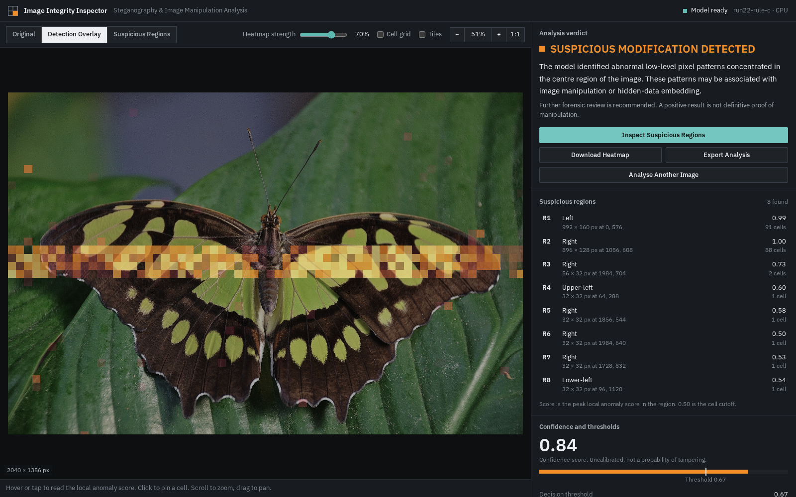
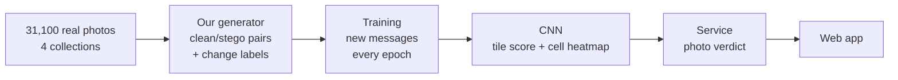
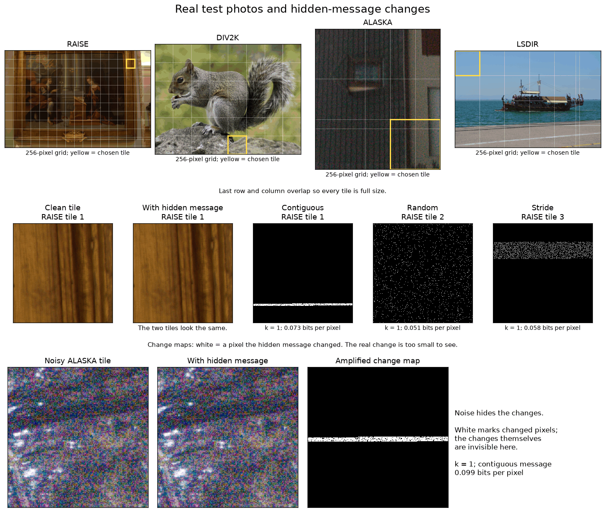
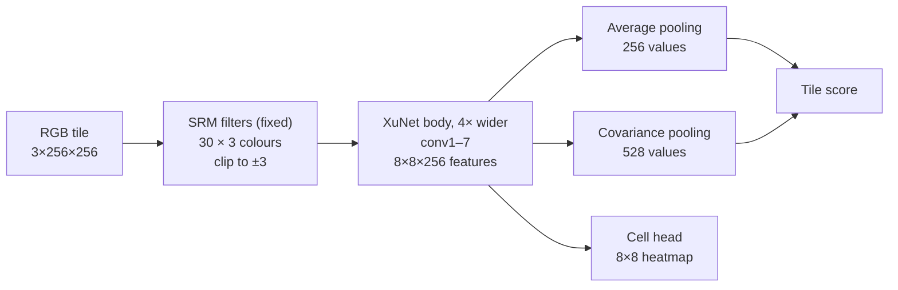
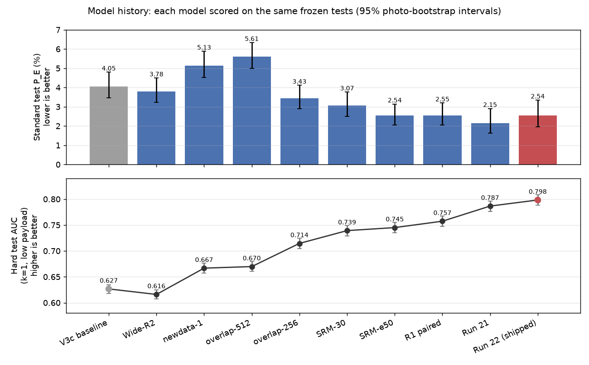
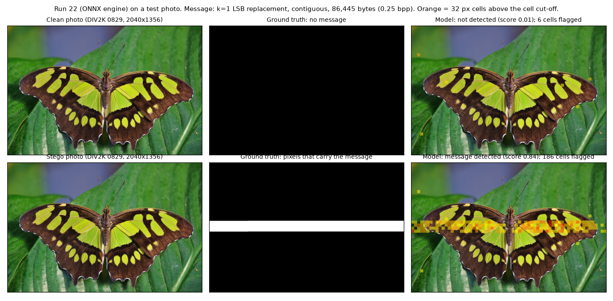
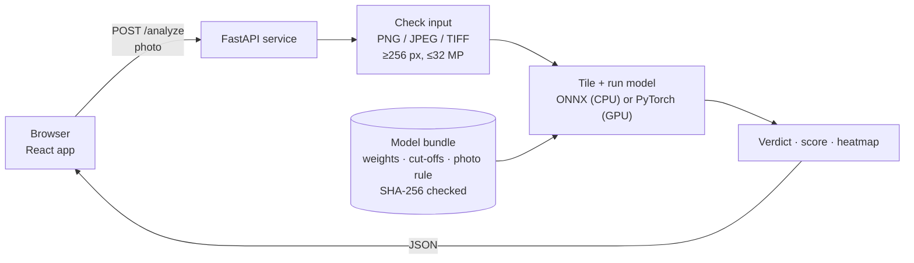

# Finding Hidden Messages in Photographs: a CNN for Colour LSB Steganalysis with a Localisation Heatmap

AAI3001 Computer Vision and Deep Learning

**Live demo:** <https://gcp-aai3001.taild62d21.ts.net> · **Run it locally:** [Appendix A](#appendix-a-run-and-reproduce) · **Shipped model:** [`deploy/run22-rule-c-v1/`](deploy/run22-rule-c-v1/)

A photo can carry a hidden message in the lowest bits of its pixels, and the change is invisible. We built a dataset, a neural network and a web tool that answer two questions about an uploaded photo: **does it carry a hidden message, and where?**



*The deployed tool on a test photo with a hidden message: verdict, score, and a heatmap over the region that carries the message.*

## Summary

| Part | Main result | Section |
| --- | --- | --- |
| **Dataset** | Our own generator turns 31,100 real photos into labelled clean/stego pairs, with a message mask and a record of every changed value. Frozen test sets, split by photo | [2](#2-dataset) |
| **Model** | A 0.64 M-parameter CNN without normalisation layers, with a second output head, trained on changed-cell targets, that draws the heatmap | [3](#3-model) |
| **Results** | Tile error rate 2.54% on the held-out RAISE + DIV2K test set (course baseline: 4.05%). Heatmap ranks changed cells above unchanged ones (AUC .864). Whole photos: 5.6% false alarms | [4](#4-results) |
| **Deployment** | Live in the cloud on a GPU, and locally as a container with an optimised ONNX model (up to 2.3× faster, 3.5× smaller, same decisions) | [5](#5-deployment) |
| **User interface** | Web app with verdict, zoomable heatmap and ranked regions | [6](#6-user-interface) |
| **Scalability** | Any photo size up to 32 MP, new cameras, new embedding settings, model swap without code changes | [7](#7-scalability-and-other-image-types) |

## Terms

| Term | Meaning |
| --- | --- |
| **LSB** | Least significant bit. The lowest bit of a pixel value (0–255). Changing it moves the value by ±1 |
| **Clean / stego** | A photo without / with a hidden message |
| **k** | How many low bits per value the message uses. k=1 changes a value by at most ±1 and is the hardest to detect; k bits can change it by up to 2<sup>k</sup> − 1 |
| **bpp** | Bits per pixel: message length divided by the number of pixels |
| **Tile / cell** | The model reads 256×256 px tiles. Each tile is split into an 8×8 grid of 32 px cells for the heatmap |
| **FA / Miss** | False alarm: a clean image called stego. Miss: a stego image called clean |
| **P_E** | Error rate: (FA + Miss) / 2. Lower is better; 50% is guessing |
| **AUC** | Chance that a random stego image scores above a random clean one. 1.0 is perfect; 0.5 is guessing |
| **SRM** | Spatial Rich Model: fixed high-pass filters that remove image content and keep the noise, where the message is |
| **ONNX** | A portable model format. ONNX Runtime runs it faster than PyTorch on CPU |

## Contents

1. [Problem and approach](#1-problem-and-approach)
2. [Dataset](#2-dataset)
3. [Model](#3-model)
4. [Results](#4-results)
5. [Deployment](#5-deployment)
6. [User interface](#6-user-interface)
7. [Scalability and other image types](#7-scalability-and-other-image-types)
8. [Limitations](#8-limitations)
9. [Conclusion](#9-conclusion)
10. [Related work](#10-related-work)

---

## 1. Problem and approach

**An LSB message changes pixel values by very small amounts (at most ±1 for a 1-bit message), so a detector must find it in the image noise.** The natural noise of the photo masks the message. The masking is strongest in noisy photos from small-sensor phone cameras.

Steganalysis is used in image forensics and content screening, where an analyst must decide which images to examine further. A score alone gives the analyst no evidence to check, so our tool also shows *where* the message most likely is.



The contributions of this work:

| # | Contribution | Section |
| --- | --- | --- |
| C1 | A deterministic, labelled LSB dataset generator with 8 kinds of embedding setting and a pixel mask for every image | [2](#2-dataset) |
| C2 | Frozen test sets split by photo, including unseen cameras, a 32-cell hard test, a heatmap test and a whole-photo test | [2](#2-dataset) |
| C3 | A detector that combines SRM filters, a widened XuNet, covariance pooling and a trained cell head | [3](#3-model) |
| C4 | A model history: 10 models scored on the same tests, so the effect of each design step is measured | [4.2](#42-what-made-the-difference) |
| C5 | A deployed system: a checked model bundle, an ONNX engine, an HTTP API, containers and a web app | [5](#5-deployment) |

---

## 2. Dataset

**We built our own labelled dataset: a generator hides messages in real photos and records exactly where the message is and which values changed.**



*Figure 1. Top: one test photo from each source, with the 256 px tile grid. Middle: a clean tile, the same tile with a message (they look the same), and the message masks for three placements. Bottom: in a noisy phone photo the noise covers the changes.*

- **Photos:** 31,100 photos from four public collections (RAISE, DIV2K, ALASKA2, LSDIR), split by photo into train, validation and test. One collection (DIV2K) and 8 camera models are never used in training.
- **Labels:** each clean/stego pair has an image label, the embedding settings, a pixel mask and an 8×8 changed-cell target. The generator is seeded, so it can re-create and verify every image byte for byte.
- **Training data on the fly:** each epoch draws 180,000 tile pairs with freshly generated messages, so the model does not train on a fixed, repeated set of stego images.

<details>
<summary><b>Details:</b> source collections</summary>

| Source | Photos | Train / Val / Test | What it adds | Licence |
| --- | ---: | --- | --- | --- |
| RAISE [[1](#ref-1)] | 1,000 Nikon RAW (NEF), 6–16 MP | 701 / 150 / 149 | Large, clean, camera-native photos | Non-commercial research and education |
| DIV2K [[2](#ref-2)] | 900 PNG, 1–4 MP | 680 / 120 / 100 | Never used in training: a source the model has not seen | Academic research only |
| ALASKA2 [[3](#ref-3)] | 18,200 TIFF, ≤1 MP, 38 camera models | 13,500 / 1,000 / 1,700 seen-camera + 2,000 unseen-camera | Many phones and cameras, very noisy photos. 8 camera models are held out completely | Source site terms |
| LSDIR [[4](#ref-4)] | 11,000 PNG, 0.3–11 MP | 7,000 / 1,500 / 2,500 | Varied web-scale scenes | Source site terms |

- No tile of a test photo is used in training or validation. Each split is frozen in a CSV file in [`data/`](data/), identified by a SHA-256 hash. [`data/<source>/photo_manifest.csv`](data/raise/) lists every photo's path, camera, size, tile grid and split.
- RAISE NEF files are decoded with one fixed set of settings: rawpy/LibRaw, AHD demosaicing, camera white balance, no auto-brightness, 8-bit output ([`lsb_raw.py`](LSB-Dataset-Generator/lsb_raw.py)). A different decoder produces different noise, so a fixed decoder keeps the clean class consistent.
- [`Datasets/README.md`](Datasets/README.md) gives the download links and checksums. Images are not stored in git.

</details>

<details>
<summary><b>Details:</b> generator settings and labels</summary>

[`LSB-Dataset-Generator/`](LSB-Dataset-Generator/README.md) turns a clean image into a clean/stego pair and writes the labels. Every random choice comes from a seeded generator. `generate.py --verify` replays a dataset and checks that every byte is the same.

| Setting | Values used in training (each drawn uniformly) | Meaning |
| --- | --- | --- |
| `bit_mode` | `lowest`, `plane` | Use the lowest *k* bits, or only bit plane *k* |
| `k` | 1, 2, 3, 4 | Bit depth (the generator supports 1–8; 5–8 is an optional test) |
| `method` | `replace`, `match` | Overwrite the bits, or ±change only when the bits differ |
| `placement` | `contiguous`, `stride`, `random` | One block, every *n*-th value, or scattered |
| `stride` | 2–16 | Step for `stride` placement |
| `payload` | `random_bytes`, `letters` | Encrypted-like data or plain text |
| `start` | random | Where the message starts |
| `size` | 0.05–0.5 bpp | Message length |

Each pair has four labels:

1. Image label: clean or stego.
2. All the drawn settings and the actual bpp.
3. A boolean pixel mask of the pixels *selected* for the message.
4. The cell target `changed_cells_v1`: an 8×8 grid per 256 px tile that counts the pixels whose values *actually changed* in each 32 px cell.

The two differ: a selected value whose low bits already equal the message bits does not change, so with encrypted-like data about half of the selected values change at k=1. The heatmap is trained on the changed values, because only they leave a trace a detector can find. The network never receives either label as an input.

**Training data.** No fixed training set is stored. Each epoch, the loader draws 180,000 clean tiles of 256×256 px from the training photos (source mix: RAISE 0.4, ALASKA 0.4, LSDIR 0.2). It embeds a new random message into a copy of each, so an epoch has 360,000 training images. In *paired* batches, a clean tile and its stego copy go into the same batch of 128 (64 pairs), so the network sees the effect of the message with the image content held constant.

</details>

<details>
<summary><b>Details:</b> frozen test sets</summary>

Every test set was built once and fixed, with a SHA-256 hash, before any model was scored on it.

| Set | Size | Purpose |
| --- | --- | --- |
| Validation set | 18,000 pairs (RAISE, ALASKA, LSDIR validation photos) | Chooses each model's decision cut-off. Never used for testing |
| Standard-256 | 10,944 pairs from 249 RAISE + DIV2K test photos | Main score |
| Domain panels | ALASKA seen-camera 2,688; ALASKA unseen-camera 3,168; LSDIR 5,280 pairs | Effect of new cameras and collections |
| Hard-256 | 4 panels × k∈{1,2} × {all, low bpp 0.05–0.15, noisy, low+noisy} = 32 cells × 1,008 = 32,256 pairs | Stress test. *Noisy* means above the source's validation 75th percentile of KV-residual noise |
| Cell-map set | 192 validation / 256 test pairs ([`configs/cell-diagnostic-v1.json`](configs/cell-diagnostic-v1.json)) | Is the heatmap in the right place? |
| Photo-verdict set | 576 test photos, each clean + 12 stego versions | Whole-photo decision |

</details>

---

## 3. Model

**A small CNN reads each 256 px tile and gives two outputs: a tile score and an 8×8 heatmap.**



*Figure 2. Run 22 network ([`cvdl/models.py`](cvdl/models.py), class `XuNetWideGAPCov32`): 638,611 trained parameters and 2,250 fixed SRM weights.*

- **SRM filters** [[5](#ref-5), [6](#ref-6)] remove image content and keep the noise, where the message is.
- **Covariance pooling** [[7](#ref-7), [8](#ref-8)] keeps how feature channels vary *together*, not only their averages. It was the most effective architecture change (§4.2).
- **The cell head** (this work) is trained on the generator's changed-cell targets, so the heatmap learns *where* the message is. It adds only 257 parameters.
- **No normalisation layers.** Both common choices let a message in one place change scores elsewhere, which a heatmap cannot allow (details below).

<details>
<summary><b>Details:</b> layers and design choices</summary>

| Block | Layers | Output |
| --- | --- | --- |
| SRM bank (fixed) | 30 high-pass filters × 3 colours, clip to ±3 | 90 residual maps |
| conv1 | 5×5 → 16, abs · tanh · pool | |
| conv2 | 5×5 → 64, tanh · pool | |
| conv3–5 | 1×1, 128 → 256 → 512, ReLU · pool | |
| conv6–7 | 1×1, 512 → 256 | 8×8×256 features |
| Average pooling | global mean | 256 values |
| Covariance pooling | 1×1 → 32 channels, 32×32 covariance, 5-step Newton–Schulz square root | 528 values |
| Classifier | Linear 784 → 2 | tile score |
| Cell head | 1×1 conv 256 → 1 | 8×8 map (one cell = 32 px) |

- *Fixed SRM front end* [[5](#ref-5), [6](#ref-6)]. Clipping at ±3 (pixel units) stops strong edges from dominating. A *trainable* SRM bank (run 20) did worse (3.34% vs 2.55%).
- *XuNet body, 4× wider, without normalisation* [[9](#ref-9)]. The absolute-value and tanh layers keep the sign symmetry of ±1 changes. Widening the 1×1 layers gave more capacity at almost no cost in speed.
- *Why normalisation was removed.* Normalisation layers rescale features with statistics computed over many positions, so a local change can move the output elsewhere. We measured this for both standard choices. With BatchNorm, a tile's score depended on the other tiles in its batch: in training mode, a batch of only clean tiles was classified correctly only 1.7–2.2% of the time. GroupNorm removed the batch dependence, but its statistics span the whole feature map: a message in one region shifted the scores of unchanged cells in the same normalised region (mean absolute cell-score shift 0.6–11.7, maximum 140). After the normalisation was removed, scores outside the changed regions did not move in 36 of 36 probe cases, and scoring a photo in parts or whole differed by at most 0.00064. A heatmap must leave clean regions unaffected by a message elsewhere, so the final network has no normalisation layers.
- *Covariance pooling* [[7](#ref-7), [8](#ref-8)]. Our independent implementation is in [`cvdl/cov_pool.py`](cvdl/cov_pool.py).
- *Cell head*. It shares the body with the tile classifier, so the heatmap adds almost no computation.

</details>

<details>
<summary><b>Details:</b> loss and training</summary>

$$\mathcal{L} = \text{CE}(\hat y_{\text{tile}}, y) + 0.2 \cdot \text{BCE}(\hat m_{\text{cell}}, m_{\text{cell}})$$

CE is the cross-entropy of the tile classifier. BCE is the binary cross-entropy of the cell head against the 8×8 changed-cell target. This loss trains the heatmap to show *where* the message is, which the class activation map (CAM) [[10](#ref-10)] of a classifier does not learn on purpose.

The cell loss has two design choices that follow from how the network sees a cell:

- *Receptive-field-aware negatives.* Each cell output sees a 48×48 px area, which reaches 8 px into its neighbours. A cell with no changed pixel of its own can therefore still see changed pixels next to it. Such "halo" cells are left out of the loss; a cell counts as clean only if its whole 48 px field is unchanged. On the heatmap test set this excluded 513 of the 16,384 cells in stego tiles.
- *Weighted positives.* A changed cell's loss is weighted by its number of changed pixels divided by 16, capped at 1. A cell with one or two changed pixels carries almost no signal, so it counts less than a cell with 16 or more.

Positive and negative cells are averaged separately within each tile, so tiles with few changed cells are not dominated by their clean cells.

Training ran in two stages, each once, on one NVIDIA RTX PRO 6000 GPU with 48 vCPUs for data loading.

| | Run 21: detector from scratch | Run 22: cell head (shipped) |
| --- | --- | --- |
| Notebook | [`srm-e50-paired-gapcov32.ipynb`](notebooks/experiments/srm-e50-paired-gapcov32.ipynb) | [`srm-cell-aux-paired-gapcov32.ipynb`](notebooks/experiments/srm-cell-aux-paired-gapcov32.ipynb) |
| Start | random initial weights | run 21 best epoch (43) |
| Loss | CE | CE + 0.2 cell BCE |
| Optimiser | AdamW, lr 3e-4, ×0.3 at epoch 8, ×0.1 at epoch 33 | AdamW, lr 3e-5 |
| Epochs × tile pairs per epoch | 50 × 180,000 | 15 × 180,000 (42,195 steps) |
| Common settings | batch 128 (64 pairs), 1 warm-up epoch, weight decay 1e-4, gradient clipping 1.0 | same |
| Training time | 151 min | 48 min |

The settings, seeds and data hashes of each run are saved with its checkpoint ([settings and seeds](docs/active/settings-and-seeds.md)).

</details>

<details>
<summary><b>Details:</b> training-pipeline optimisation</summary>

Generating the data on the fly moves photo decoding and message embedding into the training loop. The network is small, so the pipeline must make new tiles as fast as the GPU trains on them. Each change below had to leave the training data the same, byte for byte.

| Change | What it does | Measured effect |
| --- | --- | --- |
| Deterministic parallel loader | Worker processes share out the photos. Each tile's random settings come from a seed built from (run seed, epoch, photo, tile position), not from the worker | The same sample hashes from 1 process and from 4. With 32 workers on the 48-vCPU training machine, the loader supplied 3,003 tiles/s, more than the compiled network used (2,243 tiles/s) |
| 8-bit transfer | Tiles stay 8-bit integers through the worker queues and to the GPU; the conversion to float happens on the GPU | Queues hold 4× less data than with 32-bit floats |
| Decoded-photo cache (for small machines) | Each RAW photo is decoded once into a memory-mapped array file | Photo load 2.7 ms, against 293 ms from stored PNG tiles and about 684 ms to decode one RAW file. Loader on the 8-core desktop, against stored PNG tiles: 438 → 609 tiles/s with 4 workers, 739 → 1,000 with 8. The 48-vCPU machine was fast enough without it |
| Graph compilation (`torch.compile`) | Fuses the network's operations into fewer GPU kernels | GPU-only training images/s: 1,635 → 2,243 (1.37×) on the RTX PRO 6000; 1.21× on an L4; 1.24× on the desktop GPU |
| Epoch-start priming | Starts the next epoch's workers during validation, so their shuffle buffers are already full | Stall at each epoch start 11–12 s → 1 s; training part of an epoch 60–62 s → 49–51 s |
| Precision | cuDNN TF32 kept for convolutions; full FP32 for the matrix products of the covariance head | TF32 convolutions are 4–6% faster than full FP32 on an L4 |

Tested and not used: BF16 mixed precision gave only 1.10× (measured on GBRAS-Net, the slowest candidate network), and the channels-last memory layout gave no gain. The compilation and per-step rates above were measured on the 512 px model of that stage. With all the changes, run 21 trained at a steady 18 steps/s with 128 tiles per step (about 2,300 tiles/s). These changes affect training only; the deployed service has its own inference path (§5).

</details>

### 3.1 From tiles to a verdict for the whole photo

**A photo is cut into tiles, every tile and cell is scored, and a small logistic rule turns these scores into one verdict.** The photo is never resized, because resizing would erase the LSB signal.

<details>
<summary><b>Details:</b> the five steps</summary>

The service ([`cvdl/photo_inference.py`](cvdl/photo_inference.py)) works in five steps:

1. Cut the photo into 256 px tiles. The last row and column are shifted back to the edge so that every tile is full size.
2. Score every tile, and every 32 px cell. Where tiles overlap, average the cell scores.
3. Mark tiles above the tile cut-off and cells above the cell cut-off. Both cut-offs come from validation data.
4. Compute 8 features: four from the cells (flagged fraction, size of the largest connected group, and others) and four from the tiles (maximum score, mean of the top 3, flagged fraction, tile count).
5. A logistic regression on these 8 features gives the photo score. Its threshold is set for 5% false alarms on validation photos ([`cvdl/photo_verdict.py`](cvdl/photo_verdict.py)).

</details>

---

## 4. Results

**On the held-out standard test set, the shipped model (run 22) has a tile error rate of 2.54%. The weak spots are noisy phone photos and a collection it never trained on.**

| Test | Result |
| --- | --- |
| Standard test (RAISE + DIV2K, 10,944 pairs) | **P_E 2.54%**, AUC .997 (course baseline: 4.05%) |
| Hardest case: k=1, low payload (3,024 pairs) | AUC **.798** (course baseline: .627) |
| Heatmap: do changed cells score above unchanged ones? | AUC **.864** |
| Whole photos (576 test photos) | **5.6%** false alarms, 10.2% missed |

<details>
<summary><b>Details:</b> evaluation rules</summary>

- Each model's tile cut-off minimises P_E on the 18,000-pair validation set. The cell cut-off gives 5% false cells on validation. Test data never sets a cut-off.
- Each run had pass/fail criteria fixed before it was scored. Example: run 13's cell map had to beat the CAM of a control model, and its standard P_E could not rise more than 0.25 points above the control. The map passed; the P_E criterion failed by 0.07 points.
- 95% intervals come from 2,000 bootstrap resamples *of photos* (all tiles of a photo stay together). Comparisons between models use the same resampled photos (a paired bootstrap).
- All 10 models in §4.2 were re-scored on the same frozen sets, so their differences are direct comparisons.
- The score summaries, training curves and executed report notebooks of the baseline, run 21 and run 22 are in [`runs/`](runs/README.md#report-runs-summaries-tracked).

</details>

### 4.1 Accuracy by test set

**Accuracy is highest on clean camera photos and lowest on noisy phone photos.**

| Test set | P_E | Note |
| --- | ---: | --- |
| RAISE (camera RAW) | **1.76%** | |
| DIV2K (never in training) | 8.61% | Mostly false alarms (13.3%) |
| LSDIR | 7.59% | |
| ALASKA, unseen cameras | 14.87% | Lower than for seen cameras. This does not prove the model ignores camera traits: the two camera groups may differ in difficulty |
| ALASKA, seen cameras | 17.62% | Noisy phone photos |

- k=1 (one changed bit per value) is the hardest case: P_E 4.79% on the standard set, against 1.5–2.0% for k=2–4.
- A 1-bit, low-payload message in a *noisy* phone photo is close to undetectable (AUC .53–.55). The sensor noise is larger than the message.

<details>
<summary><b>Details:</b> full tables</summary>

| Test set | Pairs | AUC | FA | Miss | P_E |
| --- | ---: | ---: | ---: | ---: | ---: |
| Standard (RAISE + DIV2K) | 10,944 | .9971 | 3.1% | 2.0% | 2.54% |
| ↳ RAISE | 9,696 | .9980 | 1.8% | 1.7% | 1.76% |
| ↳ DIV2K (never trained on) | 1,248 | .9820 | 13.3% | 3.9% | 8.61% |
| ALASKA seen cameras | 2,688 | — | — | — | 17.62% |
| ALASKA unseen cameras | 3,168 | — | — | — | 14.87% |
| LSDIR | 5,280 | — | — | — | 7.59% |

By bit depth on the standard set: k=1 P_E 4.79% (AUC .991); k=2–4 P_E 1.5–2.0% (AUC ≥ .999).

Hard test, AUC / P_E% (1,008 pairs per cell):

| Panel | k=1, all bpp | k=1, low bpp | k=1, low bpp + noisy |
| --- | --- | --- | --- |
| Standard | .991 / 4.8 | .965 / 12.6 | .923 / 20.5 |
| ALASKA seen | .823 / 29.9 | .730 / 37.9 | .535 / 48.2 |
| ALASKA unseen | .862 / 25.0 | .770 / 35.3 | .552 / 47.0 |
| LSDIR | .935 / 16.5 | .878 / 26.4 | .705 / 40.1 |

The primary hard measure is k=1 at low bpp, pooled over ALASKA seen, ALASKA unseen and LSDIR (3,024 pairs): AUC .798.

</details>

### 4.2 What made the difference

**Across ten models, the error rate fell from 4.05% to 2.54%. Smaller training tiles gave the largest single gain.**



*Figure 3. Ten models re-scored on the same frozen tests. Grey: the course-style baseline. Red: the shipped model. Data: [`docs/results/model-history-2026-11-25.md`](docs/results/model-history-2026-11-25.md).*

- **256 px instead of 512 px training tiles:** −2.17 points of error. The smaller tiles match the test tiles, and each epoch covers more photos.
- **More varied photos (ALASKA, LSDIR):** +1.35 points on the standard test, but better on every other test (−1.4 to −9.9 points). We kept them, because real images also come from phones.
- **One repeat of the same recipe differed by 0.48 points.** A single repeat does not estimate run-to-run variance, but it shows that differences of this size between single runs are weak evidence.

<details>
<summary><b>Details:</b> every step with 95% intervals, and changes that did not help</summary>

| Step | Change | Δ standard P_E, points [95%] | Δ hard AUC [95%] |
| --- | --- | --- | --- |
| Baseline → Wide-R2 | 4× wider XuNet, no normalisation, k 1–4 | −0.26 [−0.54, −0.00] | −.011 [−.018, −.003] |
| Wide-R2 → newdata-1 | add ALASKA + LSDIR training photos | +1.35 [+1.06, +1.63] | +.051 [+.043, +.059] |
| newdata-1 → overlap-512 | same recipe, run again | +0.48 [+0.21, +0.73] | +.003 [−.002, +.008] |
| overlap-512 → overlap-256 | 256 px training tiles | −2.17 [−2.47, −1.87] | +.045 [+.038, +.052] |
| overlap-256 → SRM-30 | SRM bank replaces the KV filter | −0.37 [−0.63, −0.11] | +.025 [+.018, +.032] |
| SRM-30 → SRM-e50 | 50 epochs | −0.52 [−0.72, −0.32] | +.006 [+.002, +.010] |
| SRM-e50 → R1 | paired clean/stego batches | +0.00 [−0.16, +0.17] | +.012 [+.008, +.017] |
| R1 → run 21 | covariance pooling head | −0.40 [−0.65, −0.15] | +.029 [+.023, +.034] |
| run 21 → run 22 | trained cell head | +0.39 [+0.22, +0.58] | +.012 [+.009, +.015] |
| **Baseline → run 22** | **all of the above** | **−1.50 [−1.90, −1.12]** | **+.172 [+.163, +.180]** |

- Covariance pooling was the most effective architecture change: hard AUC +.029 and standard P_E −0.40 points.
- Run 22 gives up 0.39 points of standard P_E for a trained heatmap and a higher hard AUC. It was selected because localisation is one of the two aims of this work (§4.3), and because it is the first model whose photo rule met both pre-set criteria (§4.4).
- The ladder is not a one-change-at-a-time ablation: some steps changed several settings together (the first step changed width, normalisation and the k range). The course-style baseline also trained for fewer epochs, on fewer photo collections. The total gain is therefore a gain of the whole system, not of the architecture alone.
- Changes that did not help (standard P_E on the same tests): delayed pooling 3.43%; colour-separated first layer 3.66%; trainable SRM 3.34%; a low-payload curriculum 3.10%; a harder data mix 3.10%; trim or pad tiling instead of overlap 4.82–6.53%.

</details>

### 4.3 Localisation: does the heatmap point to the message?

**Training the heatmap on changed-cell targets made it clearly better than the usual class activation map (CAM).**



*Figure 4. A DIV2K test photo, clean (top) and with an 86 kB, k=1 message at 0.25 bpp (bottom). Middle: the true message location. Right: the model's heatmap. The clean photo scores 0.01; the stego photo scores 0.84, and the flagged cells follow the message band.*

| Heatmap | Changed cells score above unchanged cells (mean per-tile AUC) |
| --- | ---: |
| CAM of a model without cell training | .793 |
| **Trained cell head (shipped)** | **.864** |

Ranking is not the same as finding. At the cell cut-off chosen on validation data (4.5% of clean cells flagged on the test set), the head finds about half of the changed cells when the message is one block, but only about one in nine when it is scattered:

| Message placement | Changed cells flagged (recall) |
| --- | ---: |
| One contiguous block | 52.4% |
| Scattered at random | 11.4% |
| All test tiles pooled | 16.7% |

A scattered message spreads a few changed pixels over every cell, so each cell carries a weak signal; a block concentrates the signal in a few cells.

<details>
<summary><b>Details:</b> measure and intervals</summary>

Measure: within each stego tile with a contiguous message, do the changed cells score above the unchanged cells? We report the mean per-tile AUC on 128 test tiles.

| Map | Mean per-tile AUC [95%] |
| --- | --- |
| CAM of a model without cell training | .793 [.757, .828] |
| CAM of the cell-trained model | .806 [.770, .840] |
| Trained cell head (run 13) | .863 [.836, .890] |
| Trained cell head (run 22, shipped) | .864 [.835, .891] (pooled .873); false cells 4.5% at the validation cut-off |
| Attribution map of the detector without a cell head (run 21) | .752 [.718, .786] |

The trained head beats the untrained CAM by +.070 [+.053, +.088]. The attribution map of run 21, the strongest detector without a cell head, scores .112 [.087, .137] below the trained head of run 22. A better detector therefore does not by itself give a better map; the map needs its own training signal.

The heatmap test set has 256 test tiles: 64 from each of RAISE, ALASKA seen cameras, ALASKA unseen cameras and LSDIR, half with a contiguous and half with a random message. The per-tile AUC uses only the 128 contiguous tiles, because a random message changes all 64 cells of a tile, which leaves no unchanged cell to compare against. Flagged clean cells differ by source: RAISE 1.3%, LSDIR 2.3%, ALASKA unseen 6.7%, ALASKA seen 7.7%.

</details>

### 4.4 Whole-photo verdict

**Using tile and cell evidence together gives the best photo verdict: 5.6% false alarms and 10.2% misses.**

| Rule | False alarms | Misses | P_E |
| --- | ---: | ---: | ---: |
| (a) tiles only | 2.4% | 66.4% | 34.4% |
| (b) cells only | 9.5% | 12.5% | 11.0% |
| **(c) tiles + cells (shipped)** | **5.6%** | **10.2%** | **7.9%** |

<details>
<summary><b>Details:</b> rule fitting and results by source</summary>

576 test photos, each clean and with 12 stego versions. The rule was fitted on 224 validation photos and set to 5% false alarms on 224 others, before the test.

| Rule | FA | Miss | P_E | AUC |
| --- | ---: | ---: | ---: | ---: |
| (a) ≥ 18 tiles above the tile cut-off | 2.4% | 66.4% | 34.4% | .900 |
| (b) logistic rule on the 4 cell features | 9.5% | 12.5% | 11.0% | .945 |
| (c) 8-feature logistic rule | 5.6% | 10.2% | 7.9% | .967 |

By source, rule (c) has P_E of RAISE 1.5%, DIV2K 4.9%, LSDIR 4.3%, ALASKA unseen 12.2% and ALASKA seen 14.1%. Rule (c) beats both one-sided rules; the paired 95% interval of the P_E difference is below zero for both. Run 22 is the first model that met both criteria set before testing: FA ≤ 7%, and P_E ≤ 25% on hard k=1 low-payload photos (22.6%).

</details>

### 4.5 Diagnostic findings

**Two diagnostic experiments show where the CNN leaves signal unused: a classical statistic finds scattered 1-bit replacement better in noisy photos, and all models are more sensitive to green than to red or blue.**

A classical detector, weighted-stego analysis (WS) [[11](#ref-11), [12](#ref-12)], was compared with an earlier CNN of this work (SRM-e50, §4.2) on the same hard-test tiles. WS estimates the message length from the parity structure that LSB *replacement* leaves. On noisy ALASKA photos with a 1-bit replacement message, the whole WS 95% interval lay above the CNN in 10 of 12 conditions. The advantage was largest for scattered messages; for a contiguous block the two were tied on ALASKA, and the CNN was better on LSDIR (.894 against .753). WS found no signal in LSB *matching*, as expected, while the CNN detects both methods about equally. A better ranking did not give a better operating point: at cut-offs set on validation data, WS flagged up to 38.7% of noisy clean test tiles, against up to 19.6% for the CNN. The result shows that usable statistical evidence remains in images where the CNN is weak.

A colour experiment hid the same message in only the red, only the green or only the blue values of 480 test photos, with the same pixels and density in each case. All three models tested (runs 18, R1 and SRM-e50, before run 22) were clearly more sensitive to green. A message in red or blue alone raised the miss rate by about 5–6 points. A possible cause, not tested, is that camera sensors have two green sites in each 2×2 Bayer block and the least noise in green. This matters for colour steganalysis, since most published detectors work on greyscale images.

<details>
<summary><b>Details:</b> numbers</summary>

WS against the CNN, ALASKA seen cameras, scattered 1-bit replacement (AUC [95%]):

| Condition | WS | CNN (SRM-e50) |
| --- | --- | --- |
| Low payload | .814 [.774, .855] | .608 [.583, .637] |
| Noisy | .680 [.646, .721] | .563 [.538, .589] |
| Low payload + noisy | .575 [.559, .597] | .510 [.498, .525] |

A positive control on 416 pairs confirmed the WS implementation (AUC .994; CNN .997 on the same pairs).

Colour experiment, run 18 (AUC; 5,760 stego tiles per arm):

| Message in | Red only | Green only | Blue only | Red, green and blue |
| --- | ---: | ---: | ---: | ---: |
| AUC | .660 | **.775** | .662 | .725 |
| Change against RGB [98.3%] | −.065 [−.074, −.056] | +.050 [+.041, +.058] | −.063 [−.072, −.054] | — |

The same order held for R1 and SRM-e50, and for the cell head of run 18 (within-tile AUC: green .78–.82, red .68–.74, blue .65–.71).

</details>

---

## 5. Deployment

**The same model runs in the cloud on a GPU and locally on a CPU with an optimised ONNX model. Neither changes a single test decision.**

| Where | Engine | Server time, 2–3 MP photo | How to run |
| --- | --- | ---: | --- |
| **Cloud:** <https://gcp-aai3001.taild62d21.ts.net> | PyTorch on an NVIDIA L4 GPU | 0.27 s | Open the link |
| **Local container** | ONNX Runtime on CPU (8 cores) | 0.53 s | `podman build -f deploy/Dockerfile -t cvdl-pipeline:onnx .` then `podman run --rm -p 127.0.0.1:8000:8000 cvdl-pipeline:onnx` (Docker works the same way) |
| **Local Python** | ONNX Runtime on CPU | — | `pip install -r deploy/requirements-onnx.txt` then `python -m cvdl.pipeline.serve --engine onnx` |



- **ONNX (local):** same decisions on all 21,888 test images, 2.3× faster on 8 CPU cores, and a 3.5× smaller image (329 MB instead of 1.14 GB).
- **GPU (cloud):** 0 changed verdicts on 50 test images against ONNX, and 6–8× faster than the cloud machine's CPU.
- **Model bundle:** weights, cut-offs and photo rule are bound by SHA-256 hashes. The service refuses to start if any file does not match.

<details>
<summary><b>Details:</b> ONNX export, accuracy check and timings</summary>

The service needs no gradients, so the network is exported to ONNX ([`cvdl/pipeline/export_onnx.py`](cvdl/pipeline/export_onnx.py)). The export refuses to write the bundle record if ONNX and PyTorch differ by more than 1e-3 on 32 seeded random tiles.

| Check | ONNX FP32 vs PyTorch |
| --- | --- |
| Changed decisions on 21,888 standard test images | 0 |
| Largest difference in tile probability | 1.6e-4 |
| Standard P_E, panel P_E, hard AUC | unchanged (2.545%, 17.62 / 14.87 / 7.59%, .7983) |
| HTTP results on 3 photos | same verdicts and flagged cells |

Both service images were built from the same source. Times are the median of 3 runs on a Ryzen 7 7700:

| Container CPUs | Photo | PyTorch | ONNX | Speed-up |
| --- | --- | ---: | ---: | ---: |
| 2 | 2.8 MP (48 tiles) | 2.71 s | 1.54 s | 1.76× |
| 2 | 12 MP (192 tiles) | 10.80 s | 6.21 s | 1.74× |
| 8 | 2.8 MP | 1.19 s | 0.53 s | 2.27× |
| 8 | 12 MP | 4.74 s | 2.11 s | 2.25× |
| — | Image size | 1.14 GB | 329 MB | 3.5× smaller |

8-bit (INT8) quantisation was also tested. The best INT8 variant raised standard P_E from 2.54% to 5.78% (+3.24 points [+2.76, +3.68], 1,267 changed decisions), lowered hard AUC by .057, and was slower on 8 threads (12.1 vs 9.2 ms per tile). INT8 was not used. A likely reason is that 8-bit activations cannot keep the very small differences a ±1 change produces, but this cause was not tested separately.

</details>

<details>
<summary><b>Details:</b> cloud setup and GPU check</summary>

A Google Cloud VM (8 vCPU, 1 NVIDIA L4) runs the GPU container as a system service, with the ONNX CPU container as a fallback ([service files](deploy/gcp/)). Tailscale Funnel provides the public HTTPS address; the web app and the API share one origin. End-to-end time including the upload: 2.9 s for a 2.8 MP photo and 4.5 s for a 16 MP photo.

The GPU image is `deploy/Dockerfile.torch` built with the CUDA 13.0 torch wheel (`--build-arg TORCH_INDEX_URL=https://download.pytorch.org/whl/cu130`) and run with `--device nvidia.com/gpu=all ... --device cuda`. The VM's CPU (4 physical cores at 2.2 GHz) is about 4× slower than the desktop above, so the cloud uses the GPU:

| Same 50 test images (25 photos, clean + k=1 stego) | ONNX on the VM's CPU | PyTorch on the L4 GPU |
| --- | ---: | ---: |
| Changed photo verdicts / flagged tiles | — | 0 / 0 of 2,796 |
| Changed flagged cells | — | 7 of 168,486 (0.004%) |
| Largest tile-probability difference | — | 1.6e-3 |
| Median server time, ≤1.2 MP (ALASKA, LSDIR) | 0.53 s | 0.08 s (6.5×) |
| Median server time, 2–3 MP (DIV2K) | 2.10 s | 0.27 s (7.8×) |
| Median server time, 16 MP (RAISE) | 10.16 s | 1.67 s (6.1×) |

The small differences come from GPU arithmetic (PyTorch uses TF32 for convolutions on NVIDIA GPUs, as in training).

All deployments serve the same run 22 bundle from the same commit. `deploy.json` and `onnx.json` bind the files together ([bundle guide](cvdl/pipeline/README.md#swap-or-build-a-bundle)); a different model is deployed by supplying a different bundle folder. The service is stateless: uploads are processed in memory and not stored.

</details>

---

## 6. User interface

**The web app shows the evidence, not only a score: a verdict, a heatmap over the photo, and the suspect regions ranked by score.**

`app/` is the Image Integrity Inspector (React, Vite, Tailwind; [app guide](app/README.md)). It calls only `GET /health` and `POST /analyze`.


*Figure 5. Upload screen with the accepted formats and limits.*

The result screen for a stego photo is at the top of this page. A clean photo gets "No significant anomaly detected" with score 0.01 ([screenshot](docs/figures/report/ui-result-clean.png)).

- **Careful wording:** the verdict says "suspicious modification detected", not "hidden message found", and states that a result is not proof.
- **Evidence tools:** zoom and move the heatmap, show the cell and tile grids, export the heatmap (PNG) and the analysis (JSON).
- **Tested** on desktop, tablet and mobile screen sizes with Playwright, including axe accessibility checks.

<details>
<summary><b>Details:</b> input guidance and development</summary>

- The upload screen asks for the original file, never resized or recompressed. Input warnings from the service, for example for JPEG, are shown with the result.
- The screen states that a positive result is not proof and that a negative result is not a guarantee.
- A mock API (`npm run mock-api`) lets the UI be developed without the model.

</details>

---

## 7. Scalability and other image types

**The tool takes any photo size without resizing, handles new cameras, and accepts new models without code changes. JPEG-domain steganography is not covered.**

| Dimension | What works now | Evidence or limit |
| --- | --- | --- |
| Image size | 256×256 px to 32 MP, no resizing | Time grows linearly with tile count: 0.53 s at 2.8 MP, 2.11 s at 12 MP on 8 CPU cores |
| File formats | PNG, uncompressed TIFF, JPEG (with a warning) | JPEG compression destroys earlier LSB changes. JPEG-domain steganography needs a different detector |
| New cameras | 38 camera models; 8 held out | Unseen cameras: P_E 14.87%, better than seen cameras (17.62%) |
| New collections | DIV2K never in training | P_E 8.6%, mostly false alarms: the main gap |
| New embedding settings | The generator is configured with YAML; the same test tools score a new setting | k 5–8 tests exist (`evaluate_run.py --higher-k`). Adaptive methods (S-UNIWARD, HILL) need a new embedder and retraining |
| Throughput | Stateless service: add containers to scale out. `CVDL_THREADS` sets CPU threads | 0.27 s per 2–3 MP photo on an L4 GPU |
| Model updates | Swap the bundle folder | Three bundles (runs 13, 18, 22) already use the same service |

---

## 8. Limitations

- **Noisy phone photos:** 1-bit, low-payload messages are close to undetectable (AUC .53–.55).
- **Unseen collections:** false alarms are higher, 13.3% at tile level on DIV2K.
- **Detection, not extraction:** the tool reports *whether* and *where*, not the message content.
- **Single runs:** each recipe was trained once, with one seed. One repeat differed by 0.48 points; this is a single observation, not an estimate of the variance.
- **Test-set reuse:** the frozen test sets were never used for training or for cut-offs, but their results guided later design choices. They are not an untouched final confirmation set.
- **Validation differences:** older models chose their checkpoints with their own validation data (some at 512 px) and were given new 256 px cut-offs afterwards. Their validation photo mix also differed.
- **Confounded comparisons:** some steps of the model history changed several settings together, and the baseline had less training and less varied data (§4.2).
- **Scattered messages:** the heatmap finds 52% of changed cells for a contiguous message, but only 11% for a scattered one (§4.3).
- **Photo-verdict test:** it uses the same source collections as development, so seen-camera results are not evidence for unseen cameras.
- **Human review:** a flag is evidence for a person to check, not a finding of wrongdoing. The UI says so on every result.

## 9. Conclusion

This work presented an end-to-end system for colour LSB steganalysis: a labelled dataset generator, frozen test sets split by photo, a compact CNN with a trained localisation head, and a deployed web tool. The shipped model has a tile error rate of 2.54% on the held-out standard test set, ranks changed cells above unchanged ones (per-tile AUC .864), and gives whole-photo verdicts with 5.6% false alarms. The largest gains came from data and tile size, and from covariance pooling. Removing normalisation layers was necessary for a reliable heatmap, and training the heatmap on changed-cell targets made it clearly better than attribution maps. Noisy phone photos with very small payloads remain the open problem.

Future work follows from these results:

- **Parity-aware input.** WS detects scattered replacement better than the CNN (§4.5). An extra fixed input, the SRM residual multiplied by the parity of each pixel value, would give the CNN the same information.
- **Detectors for LSB matching.** The classical statistics see no signal in matching, so matching needs CNN-specific evidence and its own diagnostics.
- **Better localisation of scattered messages**, where the heatmap finds only 11% of changed cells.
- **Multiple training seeds**, to check whether the measured differences survive training variability.
- **Fully matched 256 px validation** for every model, so that checkpoint selection is the same across the model history.
- **More source collections** in training, to reduce false alarms on unseen collections, and **per-source calibration** of the photo score.
- **JPEG-domain steganography**, which needs a separate detector.
- **ONNX Runtime with a GPU backend**, so that GPU deployments also use the exported model.

---

## 10. Related work

- **Statistical detectors.** The chi-square attack [[13](#ref-13)] detects pairs of values that LSB replacement makes equal in frequency. RS analysis [[14](#ref-14)] and weighted-stego analysis [[11](#ref-11), [12](#ref-12)] estimate the message length. They are precise for full-image LSB replacement, but weaker for LSB matching, small payloads and local embedding.
- **Rich models.** The Spatial Rich Model [[5](#ref-5)] computes noise residuals (the image minus a prediction from its neighbours) with fixed high-pass filters, then trains a classifier on their statistics.
- **CNN steganalysis.** Qian et al. [[15](#ref-15)] started a CNN with one fixed high-pass filter (the "KV" kernel). XuNet [[9](#ref-9)] added an absolute-value layer, tanh activations and 1×1 convolutions; it is small and stable. Ye-Net [[6](#ref-6)] used the 30 SRM filters with truncation. SRNet [[16](#ref-16)], Yedroudj-Net [[17](#ref-17)] and GBRAS-Net [[18](#ref-18)] are deeper designs built mostly for adaptive embedding on greyscale 256×256 images. Deng et al. [[7](#ref-7)] showed that global covariance pooling, with iterative matrix square-root normalisation [[8](#ref-8)], helps steganalysis.
- **Localisation.** Class activation mapping (CAM) [[10](#ref-10)] reads a coarse "where" map from a network trained only on image labels.

Our setting differs in four ways: colour photos instead of greyscale; a mixture of LSB settings instead of one algorithm at one payload; messages that often fill only part of the image; and a photo-level verdict with a heatmap. We therefore kept the small XuNet family, which trains quickly and was the course baseline, and added only the parts that measurements supported.

---

## References

<a id="ref-1"></a>\[1\] D.-T. Dang-Nguyen, C. Pasquini, V. Conotter, and G. Boato, "RAISE: A raw images dataset for digital image forensics," in *Proc. 6th ACM Multimedia Syst. Conf. (MMSys)*, Portland, OR, USA, 2015, pp. 219–224, doi: 10.1145/2713168.2713194.

<a id="ref-2"></a>\[2\] E. Agustsson and R. Timofte, "NTIRE 2017 challenge on single image super-resolution: Dataset and study," in *Proc. IEEE Conf. Comput. Vis. Pattern Recognit. Workshops (CVPRW)*, Honolulu, HI, USA, 2017, pp. 1122–1131, doi: 10.1109/CVPRW.2017.150.

<a id="ref-3"></a>\[3\] R. Cogranne, E. Giboulot, and P. Bas, "ALASKA#2: Challenging academic research on steganalysis with realistic images," in *Proc. IEEE Int. Workshop Inf. Forensics Secur. (WIFS)*, New York, NY, USA, 2020, pp. 1–5, doi: 10.1109/WIFS49906.2020.9360896.

<a id="ref-4"></a>\[4\] Y. Li *et al.*, "LSDIR: A large scale dataset for image restoration," in *Proc. IEEE/CVF Conf. Comput. Vis. Pattern Recognit. Workshops (CVPRW)*, Vancouver, BC, Canada, 2023, pp. 1775–1787, doi: 10.1109/CVPRW59228.2023.00178.

<a id="ref-5"></a>\[5\] J. Fridrich and J. Kodovský, "Rich models for steganalysis of digital images," *IEEE Trans. Inf. Forensics Security*, vol. 7, no. 3, pp. 868–882, Jun. 2012, doi: 10.1109/TIFS.2012.2190402.

<a id="ref-6"></a>\[6\] J. Ye, J. Ni, and Y. Yi, "Deep learning hierarchical representations for image steganalysis," *IEEE Trans. Inf. Forensics Security*, vol. 12, no. 11, pp. 2545–2557, Nov. 2017, doi: 10.1109/TIFS.2017.2710946.

<a id="ref-7"></a>\[7\] X. Deng, B. Chen, W. Luo, and D. Luo, "Fast and effective global covariance pooling network for image steganalysis," in *Proc. ACM Workshop Inf. Hiding Multimedia Secur. (IH&MMSec)*, Paris, France, 2019, pp. 230–234, doi: 10.1145/3335203.3335739.

<a id="ref-8"></a>\[8\] P. Li, J. Xie, Q. Wang, and Z. Gao, "Towards faster training of global covariance pooling networks by iterative matrix square root normalization," in *Proc. IEEE/CVF Conf. Comput. Vis. Pattern Recognit. (CVPR)*, Salt Lake City, UT, USA, 2018, pp. 947–955, doi: 10.1109/CVPR.2018.00105.

<a id="ref-9"></a>\[9\] G. Xu, H.-Z. Wu, and Y.-Q. Shi, "Structural design of convolutional neural networks for steganalysis," *IEEE Signal Process. Lett.*, vol. 23, no. 5, pp. 708–712, May 2016, doi: 10.1109/LSP.2016.2548421.

<a id="ref-10"></a>\[10\] B. Zhou, A. Khosla, A. Lapedriza, A. Oliva, and A. Torralba, "Learning deep features for discriminative localization," in *Proc. IEEE Conf. Comput. Vis. Pattern Recognit. (CVPR)*, Las Vegas, NV, USA, 2016, pp. 2921–2929, doi: 10.1109/CVPR.2016.319.

<a id="ref-11"></a>\[11\] J. Fridrich and M. Goljan, "On estimation of secret message length in LSB steganography in spatial domain," in *Proc. SPIE, Security, Steganography, and Watermarking of Multimedia Contents VI*, vol. 5306, San Jose, CA, USA, 2004, pp. 23–34, doi: 10.1117/12.521350.

<a id="ref-12"></a>\[12\] A. D. Ker and R. Böhme, "Revisiting weighted stego-image steganalysis," in *Proc. SPIE, Security, Forensics, Steganography, and Watermarking of Multimedia Contents X*, vol. 6819, San Jose, CA, USA, 2008, Art. no. 681905, doi: 10.1117/12.766820.

<a id="ref-13"></a>\[13\] A. Westfeld and A. Pfitzmann, "Attacks on steganographic systems," in *Information Hiding (IH 1999)* (Lecture Notes in Computer Science, vol. 1768), A. Pfitzmann, Ed. Berlin, Germany: Springer, 2000, pp. 61–76, doi: 10.1007/10719724_5.

<a id="ref-14"></a>\[14\] J. Fridrich, M. Goljan, and R. Du, "Detecting LSB steganography in color and gray-scale images," *IEEE MultiMedia*, vol. 8, no. 4, pp. 22–28, Oct.–Dec. 2001, doi: 10.1109/93.959097.

<a id="ref-15"></a>\[15\] Y. Qian, J. Dong, W. Wang, and T. Tan, "Deep learning for steganalysis via convolutional neural networks," in *Proc. SPIE, Media Watermarking, Security, and Forensics*, vol. 9409, San Francisco, CA, USA, 2015, Art. no. 94090J, doi: 10.1117/12.2083479.

<a id="ref-16"></a>\[16\] M. Boroumand, M. Chen, and J. Fridrich, "Deep residual network for steganalysis of digital images," *IEEE Trans. Inf. Forensics Security*, vol. 14, no. 5, pp. 1181–1193, May 2019, doi: 10.1109/TIFS.2018.2871749.

<a id="ref-17"></a>\[17\] M. Yedroudj, F. Comby, and M. Chaumont, "Yedroudj-Net: An efficient CNN for spatial steganalysis," in *Proc. IEEE Int. Conf. Acoust., Speech, Signal Process. (ICASSP)*, Calgary, AB, Canada, 2018, pp. 2092–2096, doi: 10.1109/ICASSP.2018.8461438.

<a id="ref-18"></a>\[18\] R. Tabares-Soto *et al.*, "GBRAS-Net: A convolutional neural network architecture for spatial image steganalysis," *IEEE Access*, vol. 9, pp. 14340–14350, 2021, doi: 10.1109/ACCESS.2021.3052494.

---

## Appendix A. Run and reproduce

**Run the detector on one photo (no web app):**

```sh
python -m cvdl.pipeline photo.png --engine onnx --overlay overlay.png
```

**Run the API and the web app locally:**

```sh
podman build -f deploy/Dockerfile -t cvdl-pipeline:onnx .
podman run --rm --memory=4g -p 127.0.0.1:8000:8000 cvdl-pipeline:onnx \
  --allow-origin http://127.0.0.1:3000 --allow-origin http://localhost:3000
cd app && npm install && npm run dev        # http://127.0.0.1:3000
```

**Reproduce the training and evaluation:**

| Step | Command or file |
| --- | --- |
| Python environment (CUDA) | `uv sync` ([development guide](docs/development.md)) |
| Get the source photos | [`Datasets/README.md`](Datasets/README.md) |
| Train run 21, then run 22 | The notebooks in §4.3, through `scripts/run_notebook.py` |
| Score a run on the frozen tests | `python scripts/evaluate_run.py runs/<run>` |
| Build an ONNX bundle | `python -m cvdl.pipeline.export_onnx deploy/<bundle>` |
| Rebuild the figures | `python scripts/build_report_figures.py` |
| Run the test suite | `python scripts/test_cpu.py --level full` |

## Appendix B. Repository map

| Path | Contents |
| --- | --- |
| [`LSB-Dataset-Generator/`](LSB-Dataset-Generator/README.md) | Our embedding and labelling tool |
| [`data/`](data/) | Frozen photo lists, splits and test sets (CSV and hashes, no images) |
| [`cvdl/`](cvdl/) | Models, data loading, evaluation, photo inference |
| [`cvdl/pipeline/`](cvdl/pipeline/README.md) | Model bundle, ONNX/PyTorch engines, HTTP service |
| [`deploy/`](deploy/) | Container files and the shipped bundles |
| [`app/`](app/README.md) | Web user interface |
| [`notebooks/`](notebooks/) | Training notebooks, one per experiment |
| [`scripts/`](scripts/) | Evaluation, dataset building, report figures |
| [`docs/`](docs/README.md) | Experiment plans, result tables and development notes |
