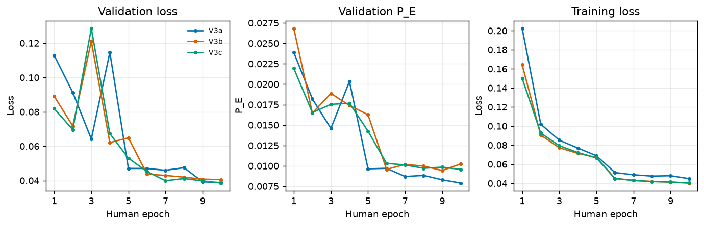
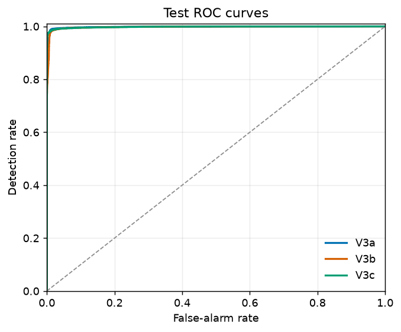
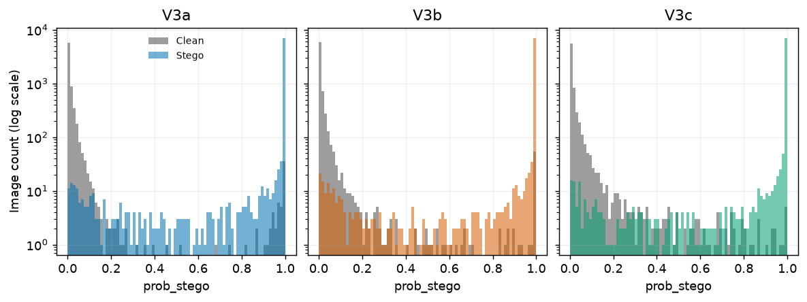
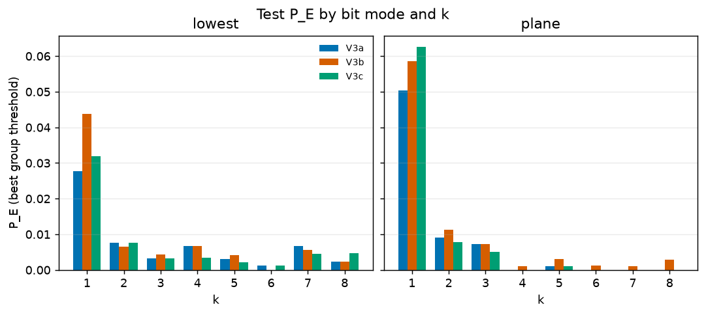
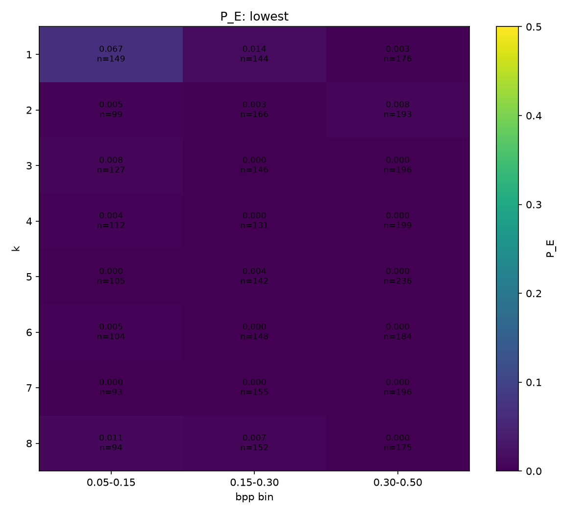
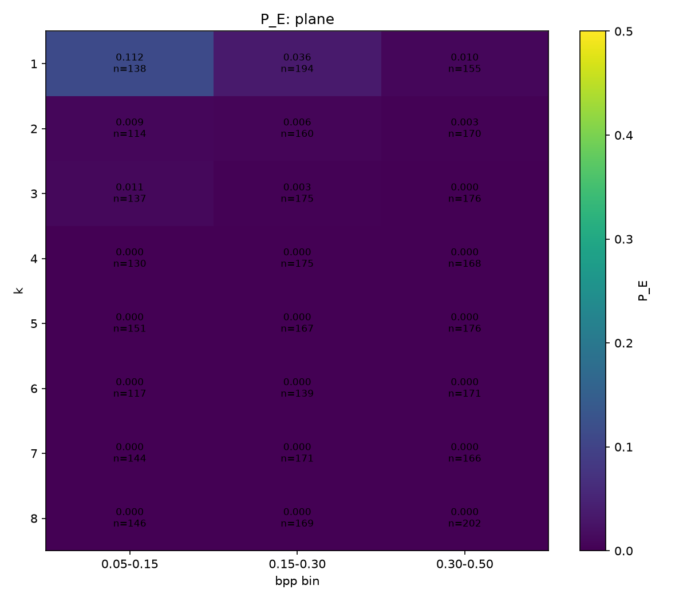
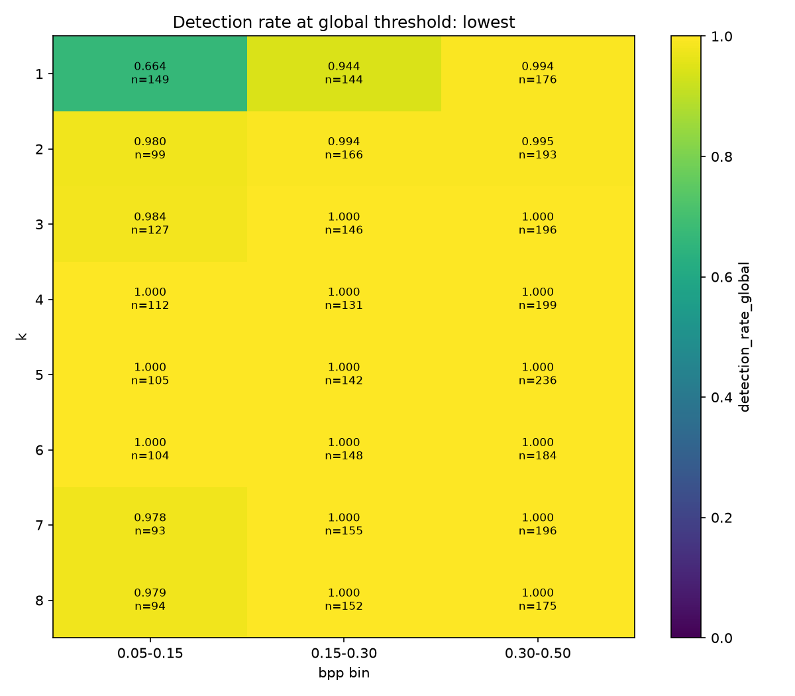
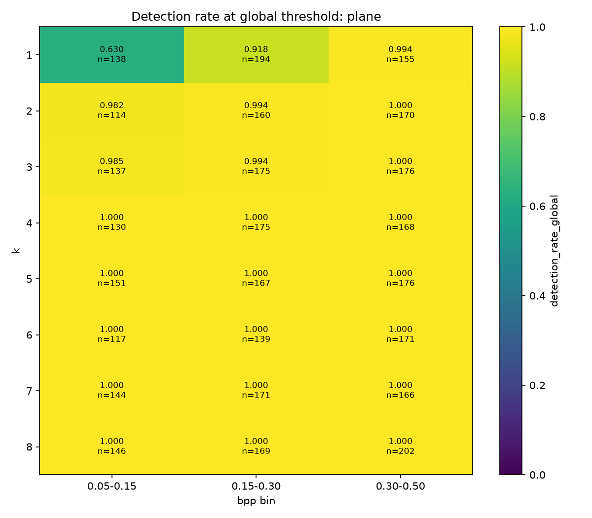

# V3 comparison results

Date: 2026-10-12

This report compares three fixes for the first steganalysis baseline. V3c is
the current baseline. The [V3b report](results-v3b.md) is a detailed
appendix with extra plots and checks for that run.

## 1. Summary

- V1 and v2 used BatchNorm with raw 0-255 KV residuals. Their scores changed
  when the batch composition changed. V2 test P_E was 0.1148.
- V3a clipped the residual to [-3, 3] and kept BatchNorm.
- V3b kept the raw residual and replaced BatchNorm with GroupNorm.
- V3c combined clipping and GroupNorm. It is batch-independent in both train
  and evaluation modes.
- V3c is the baseline because it has the best test accuracy at 0.5, and its
  best threshold is close to 0.5. Its test accuracy was 0.9858, AUC was
  0.9982, and P_E was 0.0139.
- Each version has one run and one seed. V3a used an NVIDIA L4. V3b and v3c
  used an AMD RX 9070 XT. Small differences of about 0.002 P_E can be chance.
- Plane k=1 at low bpp is the main weak spot. V3c P_E was 0.1123 for plane
  k=1 at 0.05-0.15 bpp.

## 2. The three versions

All versions use the same 512 x 512 RAISE tile data, source-photo split, KV
filter, Xu-Net-style classifier, AdamW settings, and ten epochs. Only the
normalization and clipping choices differ.

| Version | Clip | Norm | Machine | Speed | Time per epoch | Run name |
| --- | --- | --- | --- | --- | --- | --- |
| V3a | `CLIP_T=3` | `NORM="batch"` | NVIDIA L4 | about 6.7 it/s | about 6.5 min | `baseline_kv_xunet_v3_clip3_batch` |
| V3b | `CLIP_T=None` | `NORM="group"` | AMD RX 9070 XT | about 10.5 it/s (95 ms/step) | about 4 min | `baseline_kv_xunet_v3_noclip_group` |
| V3c | `CLIP_T=3` | `NORM="group"` | AMD RX 9070 XT | about 10.7 it/s (about 93 ms/step) | about 4 min | `baseline_kv_xunet_v3_clip3_group` |

V3a took 63.76 minutes for ten epochs. V3b took 39.27 minutes. V3c took
39.67 minutes. The ROCm conv1 weight-gradient fix was on for v3b and v3c. It
has no effect on the L4 run.

To reproduce a run, use [notebook 04](../notebooks/04_baseline_kv_xunet_v3.ipynb)
with `QUICK=False`, the `CLIP_T` and `NORM` values in the table, and
`ROCM_CONV1_FIX=True` for the ROCm runs. Use a new run folder for an
independent run. The v3a run used the VM. The v3b and v3c runs used the PC
ROCm container.

## 3. Training

*Figure 1. Validation loss, validation P_E, and training loss for all three
runs. Epoch numbers start at 1.*

V3b and v3c had a validation-loss spike at human epoch 3. Their val_loss
values were 0.1210675091 and 0.1285918653. V3a had a similar spike one epoch
later: val_loss rose from 0.0642 at epoch 3 to 0.1146 at epoch 4. All three
runs recovered before or at the learning-rate drop. A learning rate of 1e-3
may be too high at that point. This possible cause was not tested.

The V3a metrics came from the VM file
`/srv/aai3001/AAI3001-CVDL/checkpoints/lightning_logs/version_5/metrics.csv`.
The V3b metrics came from
`checkpoints/lightning_logs/version_2/metrics.csv`. The V3c metrics came from
`checkpoints/baseline_kv_xunet_v3_clip3_group/logs/csv/run/metrics.csv`.

## 4. Test results

All test results use 7,433 clean/stego pairs, or 14,866 images. The best
global threshold is chosen from the test scores for description. It is not a
validated deployment threshold. `P_FA` is the clean-image false-alarm rate.
`P_MD` is the stego-image miss rate.

| Version | Accuracy at 0.5 | AUC | P_E | Best threshold | P_FA / P_MD at best threshold | False alarms / misses at 0.5 |
| --- | ---: | ---: | ---: | ---: | --- | ---: |
| V3a | 0.9843 | 0.9982 | 0.0120 | 0.1646 | 0.0112 / 0.0129 | 63 / 170 |
| V3b | 0.9831 | 0.9971 | 0.0157 | 0.2833 | 0.0128 / 0.0187 | 78 / 173 |
| V3c | 0.9858 | 0.9982 | 0.0139 | 0.4588 | 0.0085 / 0.0192 | 57 / 154 |

*Figure 2. Test ROC curves. AUC is measured across all thresholds.*

*Figure 3. Clean and stego score histograms. The y-axis is logarithmic.*

V3c had the best accuracy at the fixed 0.5 threshold and the smallest gap
between the descriptive best threshold and 0.5. V3a had the lowest P_E, but
it still depends on BatchNorm behaviour in train mode.

## 5. Breakdown by embedding setting

*Figure 4. Test P_E by bit mode and k. Each bar uses its group's best
threshold.*

V3c k-by-bpp heatmaps use the single global threshold 0.458815 for detection
rates. P_E cells use each cell's best threshold.

*Figure 5. V3c P_E heatmap for the lowest bit mode.*

*Figure 6. V3c P_E heatmap for the plane bit mode.*

*Figure 7. V3c stego detection rate for the lowest bit mode at the global
threshold.*

*Figure 8. V3c stego detection rate for the plane bit mode at the global
threshold.*

The hardest V3c cells were:

| Bit mode and k | Bpp bin | Pairs | P_E | Global-threshold detection |
| --- | --- | ---: | ---: | ---: |
| Plane k=1 | 0.05-0.15 | 138 | 0.1123 | 0.6304 |
| Lowest k=1 | 0.05-0.15 | 149 | 0.0671 | 0.6644 |
| Plane k=1 | 0.15-0.30 | 194 | 0.0361 | 0.9175 |
| Lowest k=1 | 0.15-0.30 | 144 | 0.0139 | 0.9444 |

V3c P_E by bpp was 0.0270 at 0.05-0.15 bpp, 0.0089 at 0.15-0.30 bpp,
and 0.0032 at 0.30-0.50 bpp. Low payloads are harder. The plane and lowest
k=1 labels describe the same embedding at k=1; they are kept separate here to
match the historical tables.

## 6. Batch independence

Mode a uses evaluation mode. Mode c uses mixed clean and stego images with
train-mode normalization. Mode e uses an all-clean batch. Mode f uses an
all-stego batch. The values below are accuracies. For mode a, the loss is
also shown.

| Version | Set | a: eval accuracy / loss | c: mixed accuracy | e: all-clean accuracy | f: all-stego accuracy |
| --- | --- | ---: | ---: | ---: | ---: |
| V3a | Train | 0.9890 / 0.03486 | 0.9916 | 0.0169 | Not run |
| V3a | Validation | 0.9880 / 0.04339 | 0.9896 | 0.0218 | Not run |
| V3b | Train | 0.9890 / 0.03476 | 0.9906 | 0.9955 | Not run |
| V3b | Validation | 0.9885 / 0.04053 | 0.9911 | 0.9965 | Not run |
| V3c | Train | 0.9870 / 0.035752 | 0.990079 | 0.995040 | 0.984127 |
| V3c | Validation | 0.9905 / 0.041141 | 0.992560 | 0.998016 | 0.987599 |

The V3a all-clean check fails in train mode: most clean images are called
stego. V3b and v3c remain accurate in all-clean and all-stego checks. A real
detector must classify one image without needing a batch that contains both
classes. GroupNorm computes its statistics within each image, so it removes
this batch dependence. V3c's maximum train/evaluation logit difference on
identical images was 0.

The all-stego check was added by the notebook monitoring update. It was run
for v3c; it was not run for v3a or v3b.

## 7. Decision and caveats

V3c is the current baseline because it is batch-independent, has the best
accuracy at 0.5, and has a best threshold near 0.5. Its P_E is within the
observed run-to-run noise of v3a.

V3a still has lower overall P_E (0.0120 versus 0.0139) and lower plane k=1
P_E (0.0503 versus 0.0626). It is not the baseline because BatchNorm still
fails in train-mode all-clean batches.

Main caveats:

- There is one run and one seed for each version. The differences are not
  confidence intervals.
- V3a ran on an NVIDIA L4. V3b and v3c ran on an AMD RX 9070 XT. Hardware and
  model changes are not separated by this experiment.
- The test images come from one RAISE subset and one RAW-to-PNG pipeline.
- Only the project's own LSB generator was tested. Other embedding tools and
  other steganography families remain untested.
- K=1 and low bpp remain hard. Strong results on larger changes do not show
  that careful hiding is solved.

## 8. Next steps

- Pending: repeat the runs with other seeds to measure noise.
- Pending: test learning-rate warm-up for the epoch-3 spike.
- Pending: focus on plane k=1 at low bpp.
- Pending: inspect confidently wrong images, including clean images with
  `prob_stego` near 1.0.
- Pending: finish the TensorBoard chart layout and train/validation colour
  runs in notebook 04.

Related files:

- [Project journal](journal.md)
- [V3b detailed appendix](results-v3b.md)
- [V3 notebook](../notebooks/04_baseline_kv_xunet_v3.ipynb)
