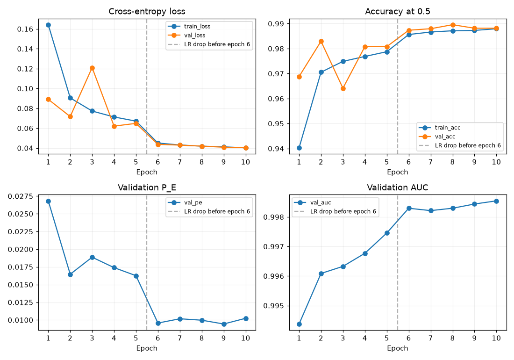
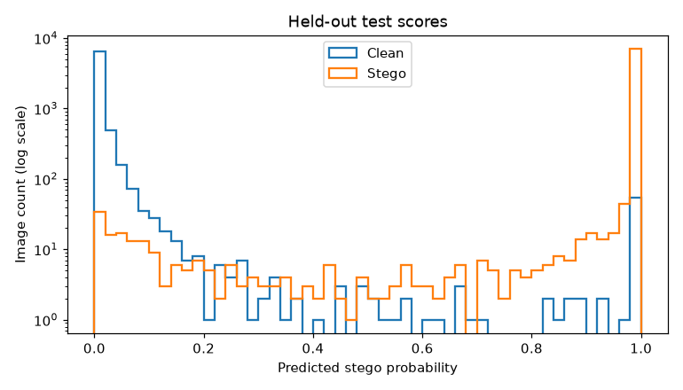
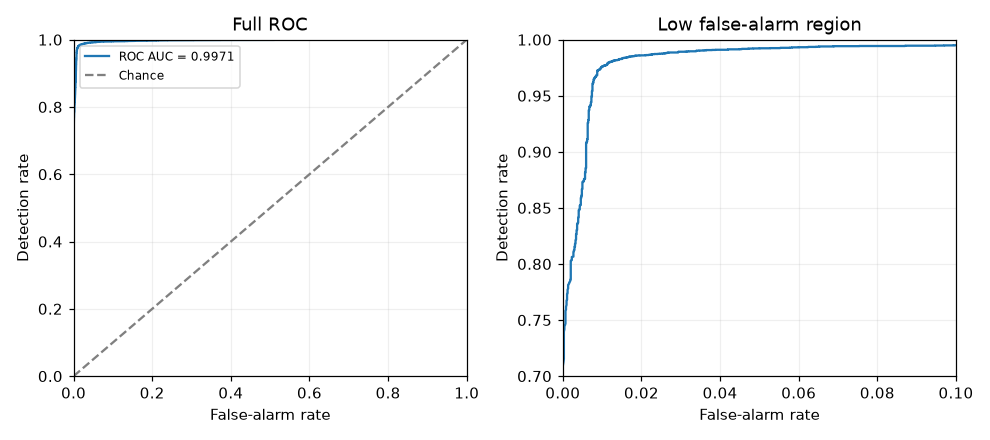
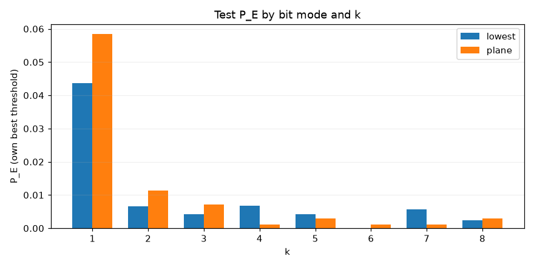
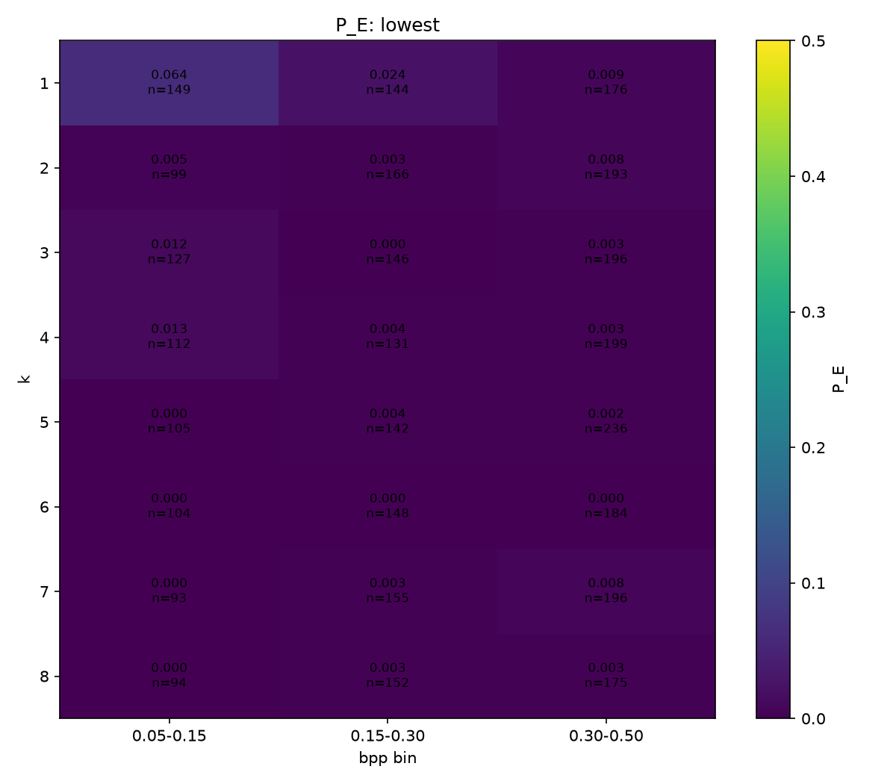
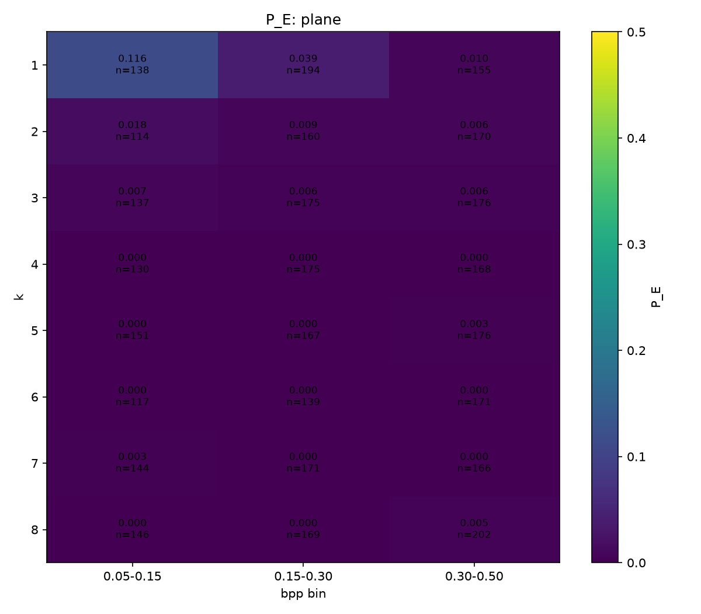
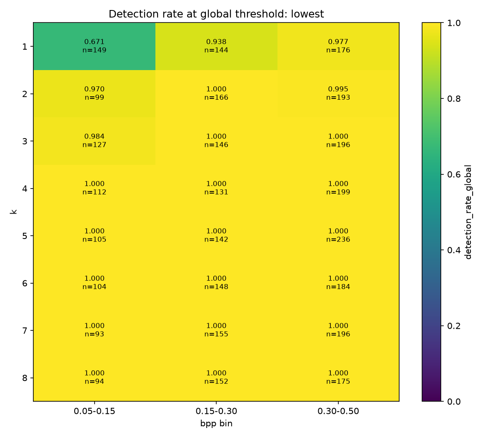
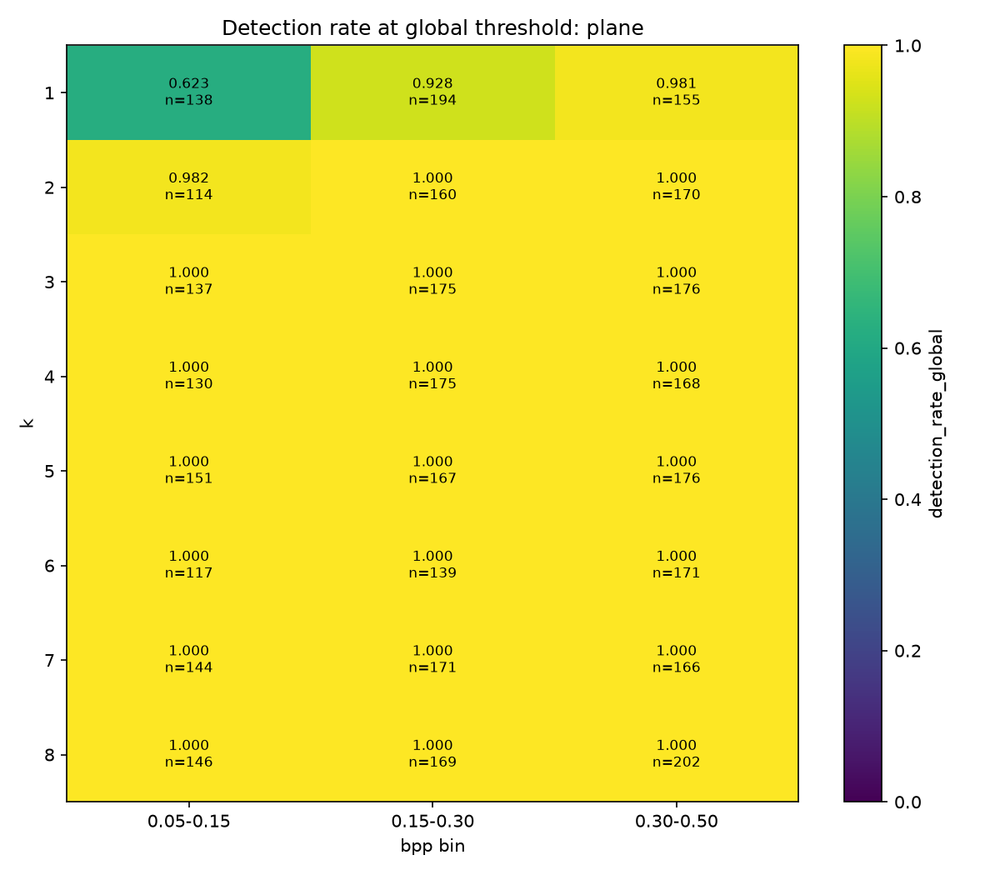

# V3b baseline steganalysis results

Date: 2026-10-12

> **Superseded.** V3c (clip 3 plus GroupNorm) replaced v3b as the baseline on
> 2026-10-12. See the [V3 comparison report](results-v3.md). This report stays
> as a detailed appendix for the v3b run.

This report records one run with one seed. It is not a claim about all images
or all embedding tools.

## 1. Summary

- V3b uses a fixed KV residual filter and an Xu-Net-style CNN with GroupNorm,
  without residual clipping. Normalization is independent of other images.
- On 14,866 test images, accuracy at 0.5 was **0.9831**, AUC **0.9971**, and
  P_E **0.0157**.
- The checkpoint was selected by validation P_E, not by the test set. The best
  checkpoint was epoch 9 of 10.
- Train and evaluation modes gave identical logits on the same images. In
  all-clean batches, clean detection accuracy was 0.996 on train samples and
  0.997 on validation samples.
- K=1 remains the weak spot, especially at low payload size. Its P_E was
  0.0437 for the lowest label and 0.0585 for the plane label.
- V3b was the baseline candidate when this report was written, because it is
  batch-independent. V3c later replaced it.
- The next test was v3c, which adds clipping at T=3 to GroupNorm. It is done;
  see the [V3 comparison report](results-v3.md).

## 2. Setup and reproduction

### Data and split

The dataset is `Datasets/raise512-run1`: 49,796 clean/stego pairs of 512 x 512
RGB tiles from 1,000 RAISE RAW photos. The source citation is [D.-T. Dang-Nguyen, C. Pasquini, V. Conotter, G. Boato, “RAISE – A Raw Images Dataset for Digital Image Forensics,” ACM Multimedia Systems, Portland, Oregon, March 18-20, 2015.](../ImageSets/README.md#citations-and-terms) Each stego tile has one random LSB
setting: lowest or plane bit mode, k=1..8, replace or match, contiguous,
random, or stride placement, letters or random bytes, and 0.05-0.50 bpp.

The split is by **source photo**, stratified by camera, not by tile. A source
photo and all its tiles stay in one split. Each pair stays in one split too.

| Split | Source photos | Clean/stego pairs | Images |
| --- | ---: | ---: | ---: |
| Train | 701 | 34,890 | 69,780 |
| Validation | 150 | 7,473 | 14,946 |
| Test | 149 | 7,433 | 14,866 |

The cameras are Nikon D40, D7000, and D90. The saved split is
`Datasets/raise512-run1/splits/split_seed0.csv`.

### Model and training

- Fixed 5 x 5 KV high-pass filter, applied separately to each colour channel.
  Its output is the image residual: small pixel changes become easier to see.
- Xu-Net-style classifier with 19,453 parameters, of which 19,378 are
  trainable. Each normalization layer is GroupNorm with 8 groups. It uses
  statistics within one image and has no running statistics.
- No residual clipping. Inputs are raw 0-255 float32; no resize or input
  normalization.
- Independently shuffled clean and stego images, 32 images per training step.
- AdamW, learning rate 1e-3, weight decay 1e-4; StepLR reduces the learning
  rate tenfold before epoch 6. Ten epochs, seed 0.
- Random horizontal/vertical flips and 90-degree rotations during training.
  No augmentation for validation or test. Full float32 precision.
- Validation P_E selects the best checkpoint. Every epoch is also saved, with
  `last.ckpt` for resume. Deterministic mode is off.

### Hardware and reproduction

The PC used an AMD RX 9070 XT in container `aai3001`, with the ROCm conv1
weight-gradient fix on. Steady training was about 10.5 steps/s, or 95 ms per
step; each epoch took about 4 minutes. Total training time was 39.27 minutes.
The configured power cap was about 255 W, not a measured mean power draw.

Use [notebook 04](../notebooks/04_baseline_kv_xunet_v3.ipynb) with:

```python
QUICK = False
CLIP_T = None
NORM = "group"
ROCM_CONV1_FIX = True
```

Clear conflicting `QUICK`, `V3_CLIP_T`, `V3_NORM`, and
`V3_ROCM_CONV1_FIX` environment overrides. Restart the kernel after changing
the ROCm switch: it sets a MIOpen environment option before importing torch.
The fix has no effect on CUDA or CPU. The run name is
`baseline_kv_xunet_v3_noclip_group`. An existing run resumes from its
`last.ckpt`; do not reuse that folder for a new independent experiment.

## 3. Why v3 was needed

V1 and v2 used BatchNorm: current-batch statistics in training, but stored
running statistics in evaluation. Their good training scores hid a large
evaluation gap. Removing clean/stego twins from training batches did not fix
it. With train-mode BatchNorm, almost every clean image in an all-clean batch
was called stego, while mixed batches scored well. The models judged images
relative to their batch.

V3 tested one change at a time:

- V3a: clip the KV residual to [-3, 3], keeping BatchNorm.
- V3b: replace BatchNorm with GroupNorm, with no clipping.

Clipping closed v3a's evaluation gap. GroupNorm also removed batch dependence.
See the [journal](journal.md) for both diagnoses and the
[v1 report](results-v1-baseline.md) for the original results.

## 4. Training curves



*Figure 1. Per-epoch loss, accuracy, validation P_E, and validation AUC. The
vertical line marks the learning-rate drop before epoch 6.*

The source is the PC file `checkpoints/lightning_logs/version_2/metrics.csv`.
A tracked copy is at
`checkpoints/baseline_kv_xunet_v3_noclip_group/logs/csv/run/metrics.csv`.
Its epoch-1 train loss
0.1643 and validation P_E 0.02683 match `logs/v3b_pc.log`. Training and
validation metrics are on separate CSV rows; the plot joins them by epoch.

Validation loss briefly rose at epoch 3, but the later run was stable through
the learning-rate drop. After the drop, validation loss fell from 0.0437 at
epoch 6 to 0.0405 at epoch 10. The lowest validation P_E was at epoch 9:
0.009434, with AUC 0.998437. The chosen file was
`best-epoch08-val_pe0.0094-val_auc0.9984.ckpt` (filenames count from zero).

The full run verified `last.ckpt` at epoch 10 (`epoch=9` in the file).
A later no-training execution restored it, stopped immediately at ten epochs,
and wrote a no-op checkpoint with `epoch=10`. Its global step stayed 21,810,
and its weights were exactly equal to the saved epoch-10 weights.

## 5. Test results

P_E is the minimum, over thresholds, of `(P_FA + P_MD)/2`. P_FA is a clean
image called stego; P_MD is a stego image missed as clean. AUC measures score
ranking across thresholds. Accuracy below uses the fixed 0.5 threshold.

| Measure | Result |
| --- | ---: |
| Test pairs / images | 7,433 / 14,866 |
| Accuracy at 0.5 | 0.9831 |
| AUC | 0.9971 |
| P_E | 0.01574 |
| Best global threshold | 0.28333 |
| P_FA at that threshold | 0.01278 (95 false alarms) |
| P_MD at that threshold | 0.01870 (139 misses) |
| P_FA at 0.5 | 0.01049 (78 false alarms) |
| P_MD at 0.5 | 0.02327 (173 misses) |

The best global threshold was found from these test scores to describe P_E.
It is **not** a separately validated deployment threshold. The model checkpoint
was selected using validation data only.



*Figure 2. Test score distributions. The count axis is logarithmic so the
small overlapping tails remain visible.*



*Figure 3. ROC curve, with a closer view of the low false-alarm region.*

The local executed notebook is
`checkpoints/baseline_kv_xunet_v3_noclip_group/v3b_pc_9070xt.ipynb`.
It reproduced the original test probabilities exactly: maximum absolute
per-image difference 0. All per-setting P_E values also matched.

## 6. Breakdown by embedding setting

### Bit mode and k



*Figure 4. Each bar uses its group's best threshold and includes paired clean
images, not just stego images.*

| k | Lowest P_E | Plane P_E |
| ---: | ---: | ---: |
| 1 | 0.04371 | 0.05852 |
| 2 | 0.00655 | 0.01126 |
| 3 | 0.00426 | 0.00717 |
| 4 | 0.00679 | 0.00106 |
| 5 | 0.00414 | 0.00304 |
| 6 | 0.00000 | 0.00117 |
| 7 | 0.00563 | 0.00104 |
| 8 | 0.00238 | 0.00290 |

At k=1, lowest and plane are **the same embedding**, not different methods.
The table retains the original label split; their difference should not be
read as a method effect. See the v1 report for the generator explanation.

### K-by-bpp heatmaps



*Figure 5. Lowest mode: P_E at a separate best threshold for each cell.*



*Figure 6. Plane mode: P_E at a separate best threshold for each cell.*



*Figure 7. Lowest mode: stego detection rate at the single global threshold
0.28333.*



*Figure 8. Plane mode: stego detection rate at the same global threshold.*

The heatmaps come from the run folder. Cells with fewer than 30 pairs are
greyed by notebook 02; no cell in this test set fell below that limit. Each
annotation includes the pair count. A detection rate uses stego images and a
single threshold; per-cell P_E includes paired clean images and can select a
different threshold. Do not read them as the same measure.

The hardest cells were:

| Setting | Bpp bin | Pairs | P_E | Global-threshold detection rate |
| --- | --- | ---: | ---: | ---: |
| Plane k=1 | 0.05-0.15 | 138 | 0.11594 | 0.62319 |
| Lowest k=1 | 0.05-0.15 | 149 | 0.06376 | 0.67114 |
| Plane k=1 | 0.15-0.30 | 194 | 0.03866 | 0.92784 |
| Lowest k=1 | 0.15-0.30 | 144 | 0.02431 | 0.93750 |
| Plane k=2 | 0.05-0.15 | 114 | 0.01754 | 0.98246 |

Across all settings, P_E was 0.02934 at 0.05-0.15 bpp, 0.01223 at
0.15-0.30 bpp, and 0.00595 at 0.30-0.50 bpp. Low payloads remain harder.

### Other settings

| Setting | Pairs | P_E |
| --- | ---: | ---: |
| Contiguous placement | 2,429 | 0.00679 |
| Random placement | 2,547 | 0.01806 |
| All stride placements combined | 2,457 | 0.01974 |
| Letters | 3,720 | 0.01667 |
| Random bytes | 3,713 | 0.01441 |
| Match | 3,679 | 0.01522 |
| Replace | 3,754 | 0.01598 |

Individual stride values have only about 150-180 pairs. Small differences
there are uncertain. These are random mixtures of other settings, not
controlled comparisons that isolate placement or payload kind.

## 7. Batch-independence checks

Seed-0 samples used 1,000 train pairs and 1,000 validation pairs. Mode a
scores 2,000 images in evaluation mode. Modes c and e each use 63 batches
of 32 images, sampled from those covers; covers can repeat across batches.

- **a:** evaluation mode, no augmentation.
- **c:** train-mode normalization, 16 clean and 16 stego images per batch,
  with distinct covers (no twins).
- **e:** train-mode normalization, all-clean batches.

| Set | a: accuracy / loss | c: accuracy | e: clean accuracy / mean prob_stego |
| --- | --- | ---: | --- |
| Train | 0.9890 / 0.03476 | 0.99058 | 0.99554 / 0.01635 |
| Validation | 0.9885 / 0.04053 | 0.99107 | 0.99653 / 0.01544 |

GroupNorm's maximum train/eval logit difference on identical images was
**0** in every check. The aggregate accuracies differ slightly because the
samplers do not score exactly the same image occurrences.

This matters in real use: a detector must not need a batch containing both
classes. V3a's all-clean training-mode accuracy was only 0.0169 on train
samples and 0.0218 on validation samples. Its evaluation mode worked well,
but its BatchNorm training path still judged images relative to the batch.
V3b removes that dependence in both modes.

## 8. Comparison with earlier baselines

All results use the same held-out test split and one seed. K=1 values retain
the historical labels, which describe the same embedding.

| Model | Accuracy at 0.5 | AUC | P_E | K=1 P_E lowest / plane | Batch independence |
| --- | ---: | ---: | ---: | --- | --- |
| V1 epoch 5 | 0.839 | 0.989 | 0.0276 | 0.103 / 0.115 | No in train mode |
| V2 epoch 1 | 0.5352 | 0.915 | 0.1148 | 0.3017 / 0.3101 | No in train mode |
| V3a epoch 10 | 0.9843 | 0.9982 | 0.0120 | 0.0277 / 0.0503 | Eval mode only |
| V3b epoch 9 | 0.9831 | 0.9971 | 0.0157 | 0.0437 / 0.0585 | Train and eval modes |

Clipping alone closed the evaluation gap. GroupNorm removes batch dependence
at a small detection cost, mostly at k=1. V3b was the baseline candidate at
this point; v3c later replaced it.

V3a ran on the L4; v3b ran on ROCm with the conv1 fix. Small differences
(roughly +/-0.002 P_E) may be run-to-run noise. That figure is a caution, not a
measured confidence interval. More seeds are needed to separate model changes
from hardware and run variation.

## 9. Limits and records

- One run and one seed; no uncertainty estimate or independent replication.
- The split prevents source-photo leakage, but all images come from the same
  RAISE subset and the same RAW-to-PNG preparation path.
- Only our own LSB generator is tested. No independent embedding tools or
  other steganography families have been tested.
- No cameras beyond the three Nikon models in this subset, and no JPEG
  pipeline, have been tested.
- K=1 and low bpp remain the weak region. Strong performance on larger
  changes does not show that careful hiding is solved.
- The test-optimal threshold is descriptive; a threshold for use on new data
  must be chosen from validation data and checked independently.

Run records are under `checkpoints/baseline_kv_xunet_v3_noclip_group/`.
Git tracks `test_predictions.csv`, `test_predictions_per_setting.csv`, the
four heatmaps, and `logs/csv/run/metrics.csv` (commit `3787b14`). Git ignores
the `.ckpt` model files and the executed notebook `v3b_pc_9070xt.ipynb`. The
model files are on the VM; see the [checkpoints guide](../checkpoints/README.md).
The training log `logs/v3b_pc.log` was deleted after its numbers were
recorded here. The report figures are committed copies or CPU plots made from
those records.

## 10. Next steps

- Done: v3c, clip 3 plus GroupNorm, one change from v3b. See the
  [V3 comparison report](results-v3.md).
- Done: notebook 04 has TensorBoard logging and per-epoch curves (`4a890d5`).
- Done: notebook 04 logs validation false-alarm and miss rates at 0.5 each
  epoch (`4a890d5`).

Open work now lives in the [V3 comparison report](results-v3.md#8-next-steps).

Related files:

- [Project journal](journal.md)
- [V1 baseline report](results-v1-baseline.md)
- [V3 notebook](../notebooks/04_baseline_kv_xunet_v3.ipynb)
- [Dataset rebuild guide](rebuild-raise512-run1.md)
