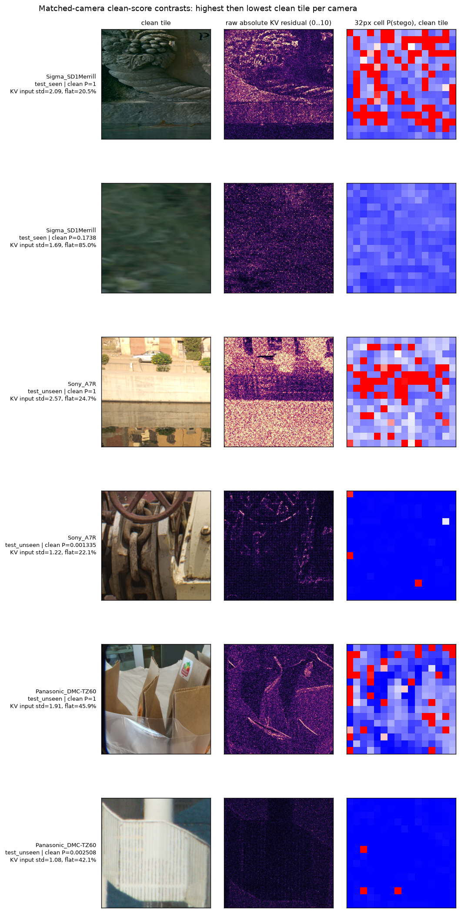

# PC check B: validation-calibrated thresholds and ALASKA tile errors

This is **analysis only**; no G4 job or training was started. It compares the earlier wide-R2 best checkpoint (`9ba63252…54a961e1`) with the mixed-source wide best checkpoint at zero-based epoch 25 (`a3866b7c…95abbbe45ae4`). Full hashes, runs, source counts, and unchanged standard-test SHA-256 are in [the mixed G4 result](result-newdata-1.md). The **new** inference for this check ran on the PC in the ROCm container with **4 evaluation workers**, after confirming the PC GPU was idle. Both checkpoints scored the **same frozen standard validation split** for this check: **9,782 RAISE and 1,456 DIV2K pairs**. Saved ALASKA/LSDIR validation and test predictions were reused: wide-R2 predictions came from the PC, and mixed-model predictions came from the completed G4 run. The new standard-val predictions and analysis CSVs are in ignored `runs/check-b/`; the six-cover image below is tracked. No test labels or test scores selected a threshold or a noise-bin edge. Test pair counts are RAISE **9,728**, DIV2K **1,228**, ALASKA seen **2,648**, ALASKA unseen **3,153**, and LSDIR **5,245**.

## How thresholds were selected

- **Source FA5:** from a source's validation *clean* scores, choose the score cutoff that gives the highest empirical false-alarm (FA) rate **no more than 5%**. Equal scores cannot be split. Apply that one cutoff unchanged to each matching test, including *both* ALASKA seen and unseen cameras.
- **Source min-P_E:** choose the validation cutoff minimizing `(FA + miss)/2`. On a tie, prefer lower validation FA. Apply unchanged to matching tests.
- **Shared FA5 and min-P_E:** repeat those rules once per model on the pooled **15,937 validation pairs** (RAISE 9,782, DIV2K 1,456, ALASKA 1,535, LSDIR 3,164). The pool uses its actual source frequencies; it is not source-balanced. Apply the one cutoff to every test source. DIV2K has a source-specific cutoff from its standard validation rows even though it was *not* in mixed-run checkpoint validation.

A prediction is stego when its score is **≥ cutoff**. Each test table reports FA on clean images, miss on all stego images, k1 miss on k1 stego images, and **P_E@cutoff = (test FA + test miss)/2**. This last number is *not* the test-optimized P_E in the earlier result. In FA5 rows, drift is `test FA − 5% target` in percentage points (pp). In min-P_E rows, drift is `test FA − validation FA` instead. No test threshold is adjusted after observing drift. The exact method and checks are in `scripts/check_b_thresholds.py` and `tests/test_check_b_thresholds.py`.

### Source-specific validation cutoffs applied to tests

| Model | Test panel | Rule | Val cutoff | Val FA % | Test FA % (drift pp) | Miss % | k1 miss % | P_E@cutoff % |
| --- | --- | --- | ---: | ---: | ---: | ---: | ---: | ---: |
| R2 | RAISE | FA5 | .023059 | 5.00 | 5.66 (+.66) | .79 | 2.85 | 3.23 |
| R2 | RAISE | min-P_E | .294886 | .79 | 1.40 (+.61) | 1.62 | 6.49 | 1.51 |
| R2 | DIV2K | FA5 | .197332 | 4.95 | 6.68 (+1.68) | 4.72 | 20.71 | 5.70 |
| R2 | DIV2K | min-P_E | .246354 | 4.19 | 5.78 (+1.59) | 5.29 | 22.49 | 5.54 |
| R2 | ALASKA seen | FA5 | **>1** | **0.00** | **0.00 (−5.00)** | **100.00** | **100.00** | 50.00 |
| R2 | ALASKA seen | min-P_E | .99999976 | 27.69 | 29.00 (+1.32) | 21.37 | 53.39 | 25.19 |
| R2 | ALASKA unseen | FA5 | **>1** | **0.00** | **0.00 (−5.00)** | **100.00** | **100.00** | 50.00 |
| R2 | ALASKA unseen | min-P_E | .99999976 | 27.69 | 26.45 (−1.24) | 20.46 | 52.16 | 23.45 |
| R2 | LSDIR | FA5 | .994522 | 4.99 | 4.44 (−.56) | 12.91 | 49.05 | 8.67 |
| R2 | LSDIR | min-P_E | .886524 | 6.64 | 6.12 (−.52) | 10.60 | 43.38 | 8.36 |
| Mixed | RAISE | FA5 | .154314 | 5.00 | 5.26 (+.26) | 1.59 | 4.67 | 3.43 |
| Mixed | RAISE | min-P_E | .444036 | .82 | 1.13 (+.31) | 3.05 | 9.42 | 2.09 |
| Mixed | DIV2K | FA5 | .364772 | 4.95 | **9.04 (+4.04)** | 4.56 | 18.93 | 6.80 |
| Mixed | DIV2K | min-P_E | .447957 | 2.82 | 7.49 (+4.68) | 5.54 | 22.49 | 6.51 |
| Mixed | ALASKA seen | FA5 | .815754 | 4.95 | **5.97 (+.97)** | 29.72 | **68.14** | 17.84 |
| Mixed | ALASKA seen | min-P_E | .651967 | 7.36 | 9.10 (+1.74) | 24.74 | 61.36 | 16.92 |
| Mixed | ALASKA unseen | FA5 | .815754 | 4.95 | **5.93 (+.93)** | 24.20 | **66.16** | 15.07 |
| Mixed | ALASKA unseen | min-P_E | .651967 | 7.36 | 8.79 (+1.42) | 19.63 | 57.51 | 14.21 |
| Mixed | LSDIR | FA5 | .479089 | 4.99 | 3.76 (−1.24) | 9.90 | 46.69 | 6.83 |
| Mixed | LSDIR | min-P_E | .472127 | 5.09 | 3.81 (−1.28) | 9.80 | 46.53 | 6.81 |

**Old ALASKA FA5 is not reachable as a useful deterministic cutoff:** **418/1,535 (27.23%)** of its validation clean tiles have score *exactly* `1.0`. Including score 1.0 exceeds the 5% FA budget; excluding it requires a cutoff above 1.0 and rejects *every* stego tile. The mixed model has **7/1,535 (0.46%)** clean validation scores exactly 1.0. Do **not** use the earlier purported old-model ALASKA “miss at 5% FA” values 21.25% (unseen) or 22.24% (seen): they split the tied score-1.0 group and their actual FA was ~25.6%/~28.3%, not 5%. No test-specific tie-breaking was used here.

The mixed model's **same ALASKA validation threshold** holds to within ~1 pp of the 5% FA target on **both** seen and unseen-camera tests. Calibration helps control false alarms, but costs **24.20% overall miss and 66.16% k1 miss** on unseen cameras. DIV2K is less stable: the mixed model's source FA5 threshold yields **9.04% test FA**, +4.04 pp above target. RAISE/LSDIR source cutoffs drift less.

### One pooled validation cutoff versus source cutoffs

| Model | Test panel | Shared rule | Val cutoff | Val FA % | Test FA % (drift pp) | Miss % | k1 miss % | P_E@cutoff % |
| --- | --- | --- | ---: | ---: | ---: | ---: | ---: | ---: |
| R2 | RAISE | FA5 | .985108 | 4.99 | .58 (−4.42) | 3.46 | 13.70 | 2.02 |
| R2 | RAISE | min-P_E | .681584 | 6.56 | .97 (−5.60) | 2.28 | 8.87 | 1.62 |
| R2 | DIV2K | FA5 | .985108 | 4.99 | 1.71 (−3.29) | 11.07 | 43.20 | 6.39 |
| R2 | DIV2K | min-P_E | .681584 | 6.56 | 3.18 (−3.39) | 8.31 | 34.32 | 5.74 |
| R2 | ALASKA seen | FA5 | .985108 | 4.99 | **38.03 (+33.03)** | 13.75 | 41.30 | 25.89 |
| R2 | ALASKA seen | min-P_E | .681584 | 6.56 | **46.45 (+39.89)** | 9.78 | 33.33 | 28.12 |
| R2 | ALASKA unseen | FA5 | .985108 | 4.99 | **36.41 (+31.41)** | 14.56 | 42.24 | 25.48 |
| R2 | ALASKA unseen | min-P_E | .681584 | 6.56 | **43.64 (+37.08)** | 10.31 | 33.84 | 26.97 |
| R2 | LSDIR | FA5 | .985108 | 4.99 | 4.96 (−.04) | 12.16 | 47.16 | 8.56 |
| R2 | LSDIR | min-P_E | .681584 | 6.56 | 7.26 (+.70) | 9.34 | 39.91 | 8.30 |
| Mixed | RAISE | FA5 | .408610 | 4.99 | 1.33 (−3.67) | 2.88 | 8.87 | 2.10 |
| Mixed | RAISE | min-P_E | .516452 | 2.66 | .73 (−1.93) | 3.48 | 10.37 | 2.11 |
| Mixed | DIV2K | FA5 | .408610 | 4.99 | 7.98 (+2.98) | 5.37 | 21.89 | 6.68 |
| Mixed | DIV2K | min-P_E | .516452 | 2.66 | 6.11 (+3.45) | 6.27 | 25.44 | 6.19 |
| Mixed | ALASKA seen | FA5 | .408610 | 4.99 | **29.53 (+24.53)** | 9.63 | 35.40 | 19.58 |
| Mixed | ALASKA seen | min-P_E | .516452 | 2.66 | **13.90 (+11.24)** | 19.64 | 53.69 | 16.77 |
| Mixed | ALASKA unseen | FA5 | .408610 | 4.99 | **24.36 (+19.36)** | 8.98 | 38.17 | 16.67 |
| Mixed | ALASKA unseen | min-P_E | .516452 | 2.66 | **12.91 (+10.25)** | 15.67 | 51.40 | 14.29 |
| Mixed | LSDIR | FA5 | .408610 | 4.99 | 5.15 (+.15) | 8.62 | 42.27 | 6.88 |
| Mixed | LSDIR | min-P_E | .516452 | 2.66 | 3.37 (+.71) | 10.45 | 48.90 | 6.91 |

A pooled mixed FA5 cutoff meets its pooled validation target but produces **29.53%/24.36% ALASKA seen/unseen FA**, while RAISE FA is only **1.33%**. One shared threshold is **not** a reliable 5%-per-source rule. A validation-selected *source* cutoff is much more consistent, but it does not fix misses of weak stego images. Operational use requires knowing the source or a separately validated source identifier; do not silently route an unknown camera through an ALASKA-specific threshold.

## ALASKA false-alarm and weak-stego review

`data/alaska/photo_manifest.csv` and `provenance.csv` contain camera group/model, photo ID and URL/hash, split, original dimensions, tile count, selection block, file bytes, and whether a photo was in selection v1. They contain **no exposure, ISO, shutter, sensor noise estimate, or per-photo demosaicing/processing parameters**. Reading TIFF tags of **all 4,700 photos** in these ALASKA val/seen/unseen panels found the same `Software=RawTherapee 5.7-53-ge10c3b2` and generic RGB/ICC tags; no exposure tags. That common software label does not explain differences between these tiles. All unseen-camera photos have `in_v1=1`, so comparing their v1 flag with seen cameras would confound selection and camera split. Within seen-camera test photos, v1 and non-v1 FA at 0.5 were **14.4% (561 clean tiles)** and **15.2% (2,087)**. This does not establish a causal v1 effect.

`scripts/check_b_tiles.py` read **7,336 unique clean covers** across ALASKA val/seen/unseen. It measured (1) standard deviation of the three-channel KV residual **after the checkpoint's ±3 input clip**, excluding the two-pixel convolution border; (2) raw RGB pixel share at 0 or 255; (3) mean luminance `0.299R + 0.587G + 0.114B`; and (4) share of 16×16 luminance blocks with std **below 5**. K1 stego errors are grouped by their *paired clean tile's* measures, not by embedding-changed pixels. The KV-noise quartiles used **validation clean covers only**: ≤1.71544, (1.71544, 2.17946], (2.17946, 2.60026], >2.60026 on the 0..255 input scale. Apply these same edges to tests. `val5` below is the mixed model's **ALASKA validation** cutoff `.815754`, not a bin-specific threshold.

| Split | KV bin | Clean / k1 pairs | FA at 0.5 / val5 % | k1 miss at 0.5 / val5 % | Raw KV std median | Clipped RGB % median | Flat-area % median |
| --- | --- | ---: | ---: | ---: | ---: | ---: | ---: |
| Val | Q1 low | 384 / 45 | 7.6 / 2.3 | 33.3 / 53.3 | 1.75 | .00 | 38.8 |
| Val | Q2 | 384 / 41 | 10.4 / 5.7 | 56.1 / 70.7 | 3.52 | .00 | 19.7 |
| Val | Q3 | 383 / 43 | 17.2 / 7.3 | 55.8 / 69.8 | 6.10 | .04 | 7.1 |
| Val | Q4 high | 384 / 45 | 21.9 / 4.4 | 77.8 / 93.3 | 14.73 | .40 | .0 |
| Seen test | Q1 low | 764 / 100 | 7.6 / 3.0 | 31.0 / 46.0 | 1.77 | .00 | 39.3 |
| Seen test | Q2 | 592 / 77 | 13.5 / 7.3 | 44.2 / 59.7 | 3.51 | .01 | 20.1 |
| Seen test | Q3 | 720 / 82 | 17.8 / 8.3 | 63.4 / 78.0 | 6.42 | .05 | 5.4 |
| Seen test | Q4 high | 572 / 80 | **23.1 / 5.6** | **75.0 / 93.8** | 14.21 | .45 | .0 |
| Unseen test | Q1 low | 1,057 / 125 | 7.6 / 4.2 | 34.4 / 40.0 | 1.75 | .00 | 39.1 |
| Unseen test | Q2 | 791 / 95 | 13.0 / 6.2 | 48.4 / 67.4 | 3.43 | .01 | 20.9 |
| Unseen test | Q3 | 731 / 92 | 17.8 / 6.8 | 55.4 / 81.5 | 6.18 | .08 | 7.6 |
| Unseen test | Q4 high | 574 / 81 | **21.3 / 7.7** | **65.4 / 87.7** | 12.92 | .53 | .0 |

Noisy/strongly textured tiles have **both** more clean false alarms and more weak-stego misses. This is not just a camera-mix artifact: the within-camera Spearman association between KV-input std and clean score is **positive in all 28 seen and all 8 unseen cameras**, median `.546` and `.544`, respectively. Across tiles, the seen/unseen Spearman values for score versus KV-input std are `.590/.571`; for clipped-RGB share `.407/.395`; for flat-area share `−.303/−.305`; for brightness `−.099/−.068`. These are descriptive correlations, **not** independent feature effects or proof that texture causes errors. E.g. high-score tiles at cutoff 0.5 have median raw KV std **6.88** versus **3.95** for correctly scored clean tiles; RGB clipping and flatness also track textures. A 1-tile original photo has seen-test FA **18.4%**, versus **9.0%** for a 4-tile photo; dimensions, content, and camera are mixed in this comparison, so it is not a processing diagnosis.

### Camera view (mixed checkpoint)

FA at 0.5 shows the existing deployment-scale problem; **FA at val5 uses exactly the same .815754 validation cutoff for every camera**, not a camera-tuned threshold. Per-camera k1 denominators are often only 7–20 for seen cameras; do not read a single 100% row as a stable camera-level estimate. The paired clean tile determines each k1 noise bin. The CSV in ignored `runs/check-b/features/bins_and_cameras.csv` also contains validation cameras and medians of other measures.

| Split | Camera | Clean / k1 pairs | Median KV-input std | FA at 0.5 % | FA at val5 % | k1 miss at val5 % |
| --- | --- | ---: | ---: | ---: | ---: | ---: |
| Seen | Sigma_SD1Merrill | 86 / 10 | 2.65 | 31.4 | 7.0 | 90.0 |
| Seen | Sony_Alpha6000 | 97 / 10 | 2.02 | 24.7 | **13.4** | 70.0 |
| Seen | LG_G7fit-LMQ850 | 94 / 14 | 2.14 | 24.5 | 9.6 | 64.3 |
| Seen | Sigma_SD10 | 96 / 20 | 2.35 | 24.0 | 7.3 | 80.0 |
| Seen | Canon_EOS-100D | 87 / 7 | 2.41 | 23.0 | 6.9 | 100.0 |
| Seen | HTC_OneA9 | 92 / 8 | 2.22 | 22.8 | 9.8 | 75.0 |
| Seen | Kodak_Z990 | 93 / 12 | 2.50 | 21.5 | 8.6 | 91.7 |
| Seen | HTC_OneM9-OPJA100 | 99 / 11 | 2.18 | 20.2 | 9.1 | 81.8 |
| Seen | Nikon_D610 | 90 / 14 | 1.75 | 17.8 | 8.9 | 35.7 |
| Seen | Panasonic_FZ28 | 90 / 10 | 2.10 | 17.8 | 2.2 | 60.0 |
| Seen | Nikon_D810 | 96 / 8 | 2.21 | 17.7 | 6.2 | 75.0 |
| Seen | Apple_IpadPro-2ndGen | 94 / 14 | 2.49 | 17.0 | 6.4 | 92.9 |
| Seen | Leica_M9 | 83 / 15 | 2.21 | 16.9 | 4.8 | 66.7 |
| Seen | Huawei_Honor8-FRDL09 | 98 / 10 | 1.98 | 13.3 | 6.1 | 70.0 |
| Seen | Nikon_D5200 | 91 / 14 | 1.68 | 12.1 | 6.6 | 50.0 |
| Seen | Canon_EOS20D | 105 / 20 | 1.84 | 11.4 | 4.8 | 50.0 |
| Seen | Nikon_D5600 | 97 / 8 | 1.91 | 11.3 | 5.2 | 62.5 |
| Seen | Nikon_D3000 | 95 / 17 | 2.22 | 10.5 | 5.3 | 70.6 |
| Seen | Nikon_D7100 | 95 / 14 | 1.81 | 10.5 | 5.3 | 28.6 |
| Seen | LG_G5-H840 | 97 / 9 | 2.36 | 10.3 | 4.1 | 77.8 |
| Seen | Canon_EOS-500D | 99 / 18 | 2.45 | 10.1 | 3.0 | 77.8 |
| Seen | Samsung_GalaxyS8-SM-G950F | 109 / 16 | 2.00 | 9.2 | 2.8 | 75.0 |
| Seen | Apple_IpadPro-1stGen | 88 / 7 | 2.36 | 9.1 | 3.4 | 85.7 |
| Seen | Pentax_K10D | 91 / 8 | 2.20 | 8.8 | 3.3 | 87.5 |
| Seen | Panasonic_DMC-GM1 | 98 / 8 | 2.13 | 8.2 | 6.1 | 62.5 |
| Seen | Nikon_1-AW1 | 99 / 12 | 2.19 | 8.1 | 4.0 | 58.3 |
| Seen | Canon_EOS700D | 96 / 11 | 1.62 | 7.3 | 5.2 | 45.5 |
| Seen | Pentax_ist-DS | 93 / 14 | 2.02 | 5.4 | 2.2 | 64.3 |
| Unseen | Panasonic_DMC-TZ60 | 376 / 51 | 2.20 | 17.6 | **8.0** | 84.3 |
| Unseen | Huawei_P20lite-ANE-LX1 | 413 / 61 | 2.07 | 16.9 | 6.3 | 62.3 |
| Unseen | Samsung_GalaxyS9plus-SM-G965F | 410 / 46 | 2.39 | 16.6 | 5.6 | **87.0** |
| Unseen | Sony_A7R | 402 / 51 | 2.07 | 16.4 | 6.5 | 66.7 |
| Unseen | Canon_EOS-60D | 396 / 41 | 2.01 | 15.4 | 6.6 | 75.6 |
| Unseen | Ricoh_GRDigital-III | 407 / 61 | 2.04 | 9.3 | 4.9 | 59.0 |
| Unseen | Google_Pixel-XL | 390 / 36 | 1.81 | 9.0 | 3.6 | 33.3 |
| Unseen | Pentax_K50 | 359 / 46 | 1.60 | 8.6 | 6.1 | 56.5 |

The figure uses **six clean covers**, highest then lowest *clean* model score within each of Sigma_SD1Merrill (seen), Sony_A7R (unseen), and Panasonic_DMC-TZ60 (unseen). Its middle column shows **raw** absolute KV residual (clipped for display to 0..10); measured KV-input std uses the model's **post-clip** ±3 residual. The right column maps the model's 32×32-pixel cell stego score, not a labeled payload mask. Sigma's high-score clean tile `alaska_62820:trim512:512:0:0:v1` scored `1.0000`, KV-input std `2.09`, while its low-score tile `alaska_62844:trim512:512:0:0:v1` scored `.1738`, KV-input std `1.69`. Sony's high/low scored `1.0000/.00134` with input std `2.57/1.22`; Panasonic's high/low `.999997/.00251` with std `1.91/1.08`. This small selected set illustrates the score/texture association; it is **not** a random sample or a causal test.

## Conclusion

There are **two problems, not just one**. A shared threshold is a calibration problem: source score distributions differ, and a validation-derived mixed ALASKA threshold holds FA near 5% even on unseen cameras. Wide-R2 has a worse calibration/score-saturation problem on ALASKA: a strict useful 5%-FA cutoff is not reachable. But the mixed model still misses **~24% of all unseen ALASKA stego and ~66% of unseen k1 stego** at its properly calibrated FA5 cutoff. Higher-KV-noise tiles raise *both* FA and k1 miss within the same noise bins, across cameras. Thus a threshold alone cannot restore weak-stego detection. Prioritize a separately approved model/data experiment on noisy/texture-heavy ALASKA tiles and k1 sensitivity; check Sigma_SD1Merrill, Sony_Alpha6000, Panasonic_DMC-TZ60, and Samsung_GalaxyS9plus-SM-G965F. Keep these held-out tests for reporting, not tuning. No further G4 run is authorized by this analysis.
