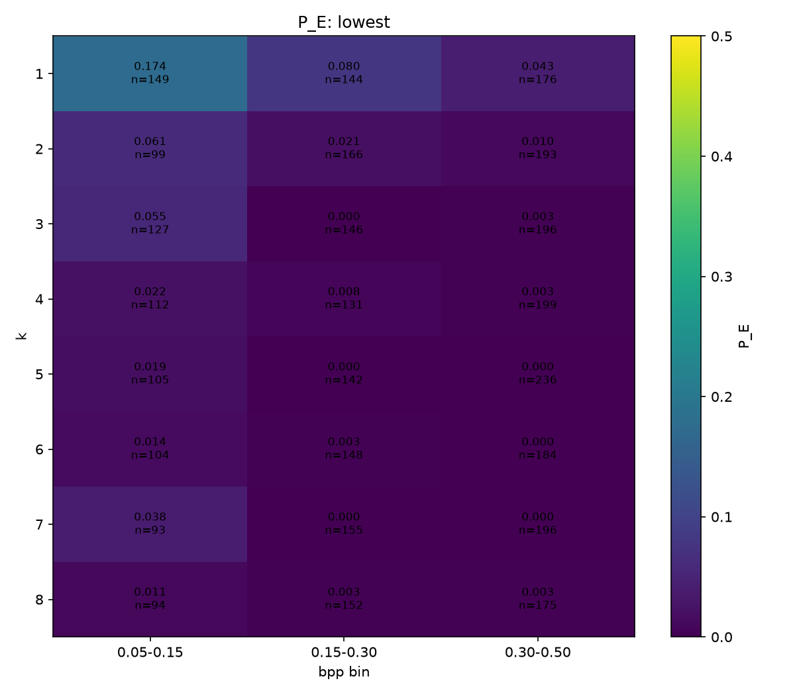
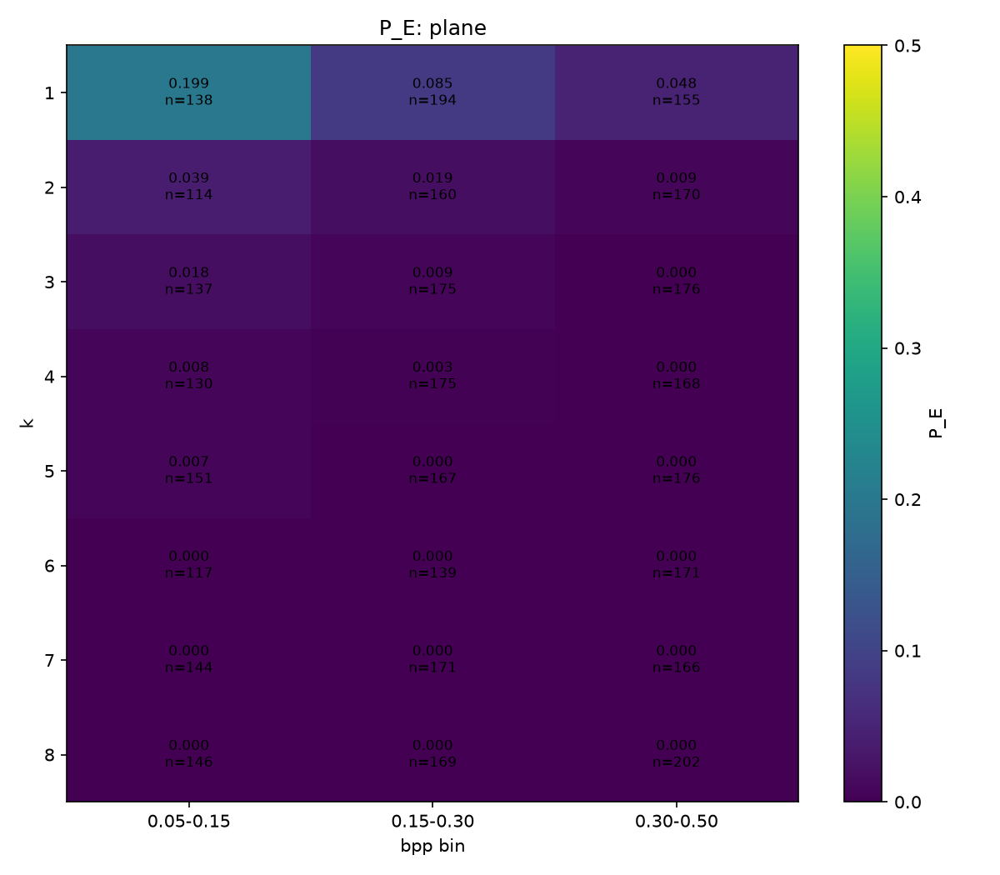

# V1 baseline steganalysis results

Date: 2026-10-12

This report describes the first steganalysis baseline. It records one PC run
with one seed. The numbers are useful for diagnosis. They are not a final
claim about all images or all embedding methods.

## 1. Summary

- The test set had 7,433 clean/stego pairs, or 14,866 images.
- The checkpoint selected by validation loss gave P_E 0.0276 and AUC 0.989.
- The score ranking was strong, but the scores were badly calibrated at the
  default 0.5 threshold. Accuracy there was 0.839.
- Most settings were easy for this small 19.5 K-parameter CNN. The hard region
  was k=1-2 with bpp at or below 0.3.
- The run exposed batch-relative judging through BatchNorm statistics, not a
  twin-pairing shortcut. V2 confirmed the problem (test P_E 0.115); running
  statistic recalibration was not a reliable fix. See section 8.

## 2. Setup

### Data

The data is in [`Datasets/raise512-run1`](../../Datasets/raise512-run1/). It has
49,796 clean 512 x 512 RGB tiles and 49,796 stego tiles. The tiles came from
1,000 RAISE RAW photos from Nikon D7000, D90, and D40 cameras. The source
citation is [D.-T. Dang-Nguyen, C. Pasquini, V. Conotter, G. Boato, “RAISE – A Raw Images Dataset for Digital Image Forensics,” ACM Multimedia Systems, Portland, Oregon, March 18-20, 2015.](../../ImageSets/README.md#citations-and-terms)

Each stego tile has one randomly selected setting:

| Setting | Values in this run |
| --- | --- |
| `bit_mode` and `k` | `lowest` or `plane`; `k=1..8` |
| `method` | `replace` or `match` |
| `placement` | `contiguous`, `stride` (2 to 16), or `random` |
| `payload_kind` | `random_bytes` or `letters` |
| `bpp` | 0.05 to 0.5 |

The split is 70/15/15 by **source photo**, stratified by camera. A source
photo never crosses a split. The test set is 7,433 pairs.

### Model and training

The model starts with a fixed **KV filter**. This is a high-pass filter that
keeps image changes and suppresses smooth content. It runs separately on each
colour channel. The result is called a residual. An Xu-Net-style CNN then
classifies the residual. The model has 19.5 K
parameters.

The input is raw 0-255 float32 data. Training used Adam with learning rate
1e-3, StepLR with a tenfold drop after epoch 5, batch size 16 twins (32
images), and flips or 90-degree rotations applied in the same way to both
twins. A **twin** is a clean tile and its stego version. They show the same
picture.

The PC run used an AMD RX 9070 XT. It stopped during epoch 9 of 10. Test
predictions used `epoch04-val_loss0.3209.ckpt`, the epoch-5 checkpoint with the
lowest validation loss. The checkpoint was chosen from validation data only.
The test score was therefore not used to choose the checkpoint.

## 3. Key terms for this experiment

- **Steganography** hides data in an image. **Steganalysis** looks for the
  hidden data without needing to read the message.
- A **cover** or **clean** image is the original. A **stego** image is the same
  image after data was embedded.
- **LSB** means least significant bit. It is the bit that changes the numeric
  pixel value by the smallest amount.
- `k` controls which bits are used. In `lowest` mode, `k` low bits are used. In
  `plane` mode, one bit plane is used: `k=1` is the LSB and larger `k` values
  select higher planes. Larger changes are easier to see.
- `replace` overwrites the target bits directly. `match` reaches the target
  bits by adding or subtracting (in plane mode, `v +/- 2^(k-1)`), choosing the
  direction at random. It changes about as many values by a similar amount, but
  it avoids the known statistical pattern of `replace`: values only swap inside
  fixed pairs such as `2i` and `2i+1`, which classic LSB detectors use.
- **Placement** controls where payload bits go. `contiguous` uses nearby carrier
  values, `stride` skips by a fixed step, and `random` chooses positions.
- **Payload kind** is either uniform random bytes or letters. It changes the
  bit pattern, not the image size.
- **bpp** means bits per pixel. A 512 x 512 tile has 262,144 pixels. In this
  dataset, 0.05 bpp is about 1.6 KB and 0.5 bpp is about 16 KB. Bpp counts
  pixels; each pixel has three colour values.
- **P_E** is the minimum, over thresholds, of `(P_FA + P_MD) / 2`. `P_FA` is a
  clean image called stego. `P_MD` is a stego image missed as clean. P_E=0 is
  perfect and P_E=0.5 is guessing. P_E is useful here because accuracy depends
  on one chosen threshold, while P_E shows the best balance of the two errors.
- A **global-threshold detection rate** uses one threshold for all groups. A
  per-group P_E may choose a different best threshold for each group. They are
  not the same measure and should not be compared as if they were.
- **Calibration** asks whether a score behaves like a probability. For example,
  scores near 0.8 should be stego about 80% of the time. A model can rank
  images well but still have poor calibration.

## 4. Overall result

| Measure | Result |
| --- | ---: |
| Test images | 14,866 |
| Test pairs | 7,433 |
| P_E | 0.0276 |
| AUC | 0.989 |
| Best global threshold | 0.981 |
| P_FA at that threshold | 0.010 |
| P_MD at that threshold | 0.045 |
| Accuracy at threshold 0.5 | 0.839 |

The clean-image `prob_stego` score quantiles were 0.277 at the median, 0.813
at the 90th percentile, and 0.982 at the 99th percentile. Thus the model
ranked the test images well, but many clean images received high scores.

At the global threshold, the original k=1 labels gave detection rates of 0.768
for `lowest` and 0.735 for `plane`. The generator code shows that these labels
make the same k=1 embedding, so the two rates should not be read as different
methods. The overall bit-mode rates were about 0.95 to 0.96. These rates use
one threshold. The per-setting P_E values below select a threshold for each
setting, so they answer a different question.

## 5. Where it fails: k and payload size

The aggregate P_E by bit mode and k was:

| k | lowest | plane |
| ---: | ---: | ---: |
| 1 | 0.103 | 0.115 |
| 2 | 0.031 | 0.027 |
| 3 | 0.020 | 0.008 |
| 4 | 0.009 | 0.004 |
| 5 | 0.007 | 0.002 |
| 6 | 0.005 | 0.000 |
| 7 | 0.010 | 0.000 |
| 8 | 0.007 | 0.000 |

The k=1 row retains the historical label split; it is one embedding, as
explained below.

### k=1 is one setting with two labels

I checked `LSB-Dataset-Generator/lsb_engine.py`. For `k=1`, `lowest` and
`plane` both replace bit 0. Their `match` paths also choose the same nearest
value, `v - 1` or `v + 1`, with a random direction at a tie. This remains the
same at edge values 0 and 255: the out-of-range choice is rejected in both
paths, so only the valid direction is used. They differ starting at `k=2`:
`lowest` changes bits 0 and 1 (up to +/-3), while `plane` changes only bit 1
(+/-2) and keeps bit 0.

The combined k=1 result is:

| k=1 group | pairs | P_E |
| --- | ---: | ---: |
| All k=1 | 956 | 0.111 |
| 0.05-0.15 bpp | 287 | 0.188 |
| 0.15-0.30 bpp | 338 | 0.086 |
| 0.30-0.50 bpp | 331 | 0.045 |

The old `lowest` and `plane` values (0.103 and 0.115) have a gap within
sampling noise, roughly +/-0.01-0.015 for about 470 pairs each. The heatmaps
below retain their original labels, but their k=1 rows are the same embedding;
use the combined table above for the k=1 result.

P_E by bpp bin was 0.055 for 0.05-0.15, 0.023 for 0.15-0.30, and 0.008
for 0.30-0.50. The hardest heatmap cells were k=1 at low payload:

| Setting | 0.05-0.15 bpp | 0.15-0.30 bpp | 0.30-0.50 bpp |
| --- | ---: | ---: | ---: |
| lowest, k=1 | 0.174 (n=149) | 0.080 (n=144) | 0.043 (n=176) |
| plane, k=1 | 0.199 (n=138) | 0.085 (n=194) | 0.048 (n=155) |
| lowest, k=2 | 0.061 | 0.021 | 0.010 |
| plane, k=2 | 0.039 | 0.019 | 0.009 |

*Figure 1. P_E heatmap for the `lowest` bit mode.*

*Figure 2. P_E heatmap for the `plane` bit mode.*

The hard cases are also the more useful cases for a careful hider: low k and
small payloads. The model solves the easier settings, but that does not show
that it can detect a careful embedding.

## 6. What did not matter much

- `replace` and `match` gave P_E 0.028 and 0.027.
- `random_bytes` and `letters` gave P_E 0.026 and 0.029.
- `contiguous` and `random` gave P_E 0.018 and 0.026.
- Stride values ranged from 0.00 to 0.07. Each value had only about 150 pairs,
  so this result is noisy.

About 80% of settings were near-solved by this 19.5 K-parameter model. The
main separation was k and bpp, not payload text or method.

## 7. Calibration quirk

The best global threshold was 0.981, not 0.5. Accuracy at 0.5 was 0.839,
while AUC was 0.989. This means the ranking was useful, but the score values
were not reliable probabilities. The high clean-image quantiles show the same
problem.

For this reason, future runs must report both a threshold-free ranking measure
such as AUC and a threshold metric such as accuracy or P_E. They should also
report calibration when a probability threshold is used.

## 8. Training behaviour and the BatchNorm shortcut

The training log showed this pattern:

| Point | Validation result | Train accuracy |
| --- | --- | ---: |
| Epoch 3 | val_acc 0.598 | not recorded |
| Epoch 5 | val_loss 0.3209, the best checkpoint | not recorded |
| Epoch 6 | val_loss 2.28, val_acc 0.611 | 0.980 |
| Epoch 8 | val_loss 29.6, val_acc 0.501 | 0.982 |
| Epoch 9 | val_loss 33.7, val_acc 0.500 | 0.982 |

BatchNorm uses statistics from a training batch, but running statistics in eval
mode. A VM check used 1,000 train pairs and 1,000 validation pairs:

| Set | Eval mode | Train-mode BatchNorm with twins together |
| --- | ---: | ---: |
| Train accuracy | 0.5125 | 0.969 |
| Validation accuracy | 0.506 | 0.963 |
| Loss | about 13 | 0.104 train, 0.113 validation |

The first check suggested a twin shortcut, but did not separate twin pairing
from batch statistics. Two follow-up diagnoses correct that explanation.
On the same seed-0 samples, train-mode BatchNorm scored almost the same with
random unpaired batches and twins together: validation accuracy was
0.961 versus 0.959 for v2 epoch 1, and 0.978 versus 0.978 for v1 epoch 5.
Twins were not the cause.

With stored running statistics, validation accuracy was 0.541 for v2 and
0.859 for v1. Recalibration with 100 unpaired train batches improved v2 to
0.750 but reduced v1 to 0.544. It is not a reliable fix; v1's good epoch 5
was partly luck in its stored statistics.

Batch composition was decisive. All-clean batches gave accuracy 0.003-0.012
and mean stego probability 0.97-0.99, while mixed 50/50 batches gave accuracy
0.96-0.98. Both models judge images relative to their batch. The current
explanation is BatchNorm applied to raw 0-255 KV residuals with widely varying
texture and high-k stego: first-layer batch variance varied about 45-50 times.

V2 finished 10 L4 epochs with unpaired training images, but did not close the
gap. Its best-validation-accuracy epoch-1 checkpoint gave test accuracy 0.5352,
AUC 0.915, and P_E 0.1148 (about 0.115). Accuracy-based selection uses the
broken 0.5 threshold; future runs select by validation P_E and save every
epoch. Full tables and the v3 plan are in the
[2026-10-12 journal entry](../journal/README.md).

## 9. What this means for next steps

- Focus future data and larger models on k<=2 and bpp<=0.3.
- In the next dataset version, merge `lowest, k=1` and `plane, k=1` into one
  k=1 setting, or report their results as one combined group.
- Done: Compared v2 with v1 on the same test split. V2 test accuracy was 0.5352, AUC was 0.915, and P_E was 0.1148.
- Done: Checked v2 at threshold 0.5 and its calibration. Test accuracy was 0.5352, AUC was 0.915, and P_E was 0.1148.
- Follow-up baseline: [V3b results](results-v3b.md).
- Fix or replace the BatchNorm behaviour before trusting a larger model.
- Use more seeds before drawing a final conclusion.

## 10. Limits and records

- This is one run and one seed. Treat the numbers as approximate.
- The test set comes from the same generated dataset family and has one random
  setting per stego tile.
- The v1 run stopped early in epoch 9. Test evaluation used the fair epoch-5
  validation-selected checkpoint, but later training behaviour is still useful
  only as a diagnosis.
- Each stride value has only about 150 pairs. Stride comparisons are therefore
  uncertain.
- Local-only PC records (ignored by git; these paths do not work on GitHub)
  are `runs-out/early-pc/baseline_kv_xunet/test_predictions.csv`,
  `runs-out/early-pc/baseline_kv_xunet/test_predictions_per_setting.csv`, and
  `runs-out/early-pc/baseline_kv_xunet/baseline_pc_9070xt.ipynb`. These
  local files are not part of the report commit.

Related files:

- [Project journal](../journal/README.md)
- [Baseline notebook](../../notebooks/01_baseline_kv_xunet.ipynb)
- [Dataset rebuild guide](../archive/rebuild-raise512-run1.md)
